# SOFTWARE DESIGN DOCUMENT (SDD)

## Sistem Informasi Layanan Pemesanan Konten Medkreminfo BEM FT UNSOED

**Tugas 3 · IF21307 Analisis dan Desain Sistem · tahap v1.0 (Pertemuan 10) dan v1.1 (Pertemuan 11)**

> Catatan penyusun: berkas ini adalah salinan kumulatif. Bab 1–5 dan 6.1 adalah isi tahap **v1.0**; Bab 6.2, Bab 7 (RTM 7.1 s.d. Defect Log 7.5), dan Lampiran A adalah penambahan tahap **v1.1**. Baris peer review pada Bab 7.5 ditandai `[ISI SAAT PEER REVIEW]` karena menunggu pertukaran dokumen dengan kelompok lain.

---

## Kendali Dokumen

| Atribut | Isi |
|---|---|
| Nama sistem | Sistem Informasi Layanan Pemesanan Konten Medkreminfo BEM FT UNSOED |
| Kelompok dan anggota | Timotius Willy Narendra (H1D025052, PM); Fardizza Vinda Rahman (H1D025067, Analis); Adridinan Najmi Faza (H1D025059, Dev); Salman Thufail (H1D022109, Dev) |
| Versi dokumen | v1.1 (kumulatif; memuat perbaikan atas SDD v1.0) |
| Tanggal pengumpulan | V1.0; 11 November 2026 & V1.1; 18 November 2026 |
| SRS acuan | SRS v1.0 (baseline Milestone 2) — `Tugas 2/Draft_SRS_Medkreminfo.md` / `Draft_SRS_Medkreminfo.docx` |
| Repository artefak | https://github.com/najmifaza/Tugas-ADS-smst-3 (folder `Tugas Per 11`) |

---

# 1. Pendahuluan

## 1.1 Tujuan Dokumen SDD

Dokumen Software Design Document (SDD) ini disusun sebagai kelanjutan dari dokumen Software Requirements Specification (SRS) v1.0 untuk Sistem Informasi Layanan Pemesanan Konten Medkreminfo BEM FT UNSOED. Tujuan utama dokumen ini adalah menyediakan spesifikasi rancangan arsitektur logis, interaksi objek, struktur penyimpanan data yang konsisten, dan model kelas domain yang dapat ditelusuri (traceable) secara transparan sebelum melangkah ke tahap konstruksi perangkat lunak.

Secara operasional, dokumen ini mentransformasikan 16 kebutuhan fungsional (FR-01 sampai FR-16), 6 kebutuhan nonfungsional (NFR), dan 5 aturan bisnis (BR-01 sampai BR-05) pada SRS menjadi empat cetak biru yang saling terikat: (1) desain interaksi dinamis berupa Sequence Diagram dan tabel spesifikasi skenario operasional, (2) skema basis data ternormalisasi hingga Bentuk Normal Ketiga (3NF) dalam notasi Crow's Foot, (3) kamus data logis beserta daftar Integrity Constraint yang menyatakan di mana tiap aturan ditegakkan, dan (4) model kelas domain UML yang memuat operasi perilaku bisnis beserta kontrak operasinya. Setiap keputusan desain pada dokumen ini wajib menunjuk balik ke kode FR/NFR/BR/AC pada SRS, sehingga tidak ada elemen desain yang muncul tanpa alasan kebutuhan.

## 1.2 Keterkaitan dengan Artefak Baseline Hulu

| Kode Artefak Acuan | Nama Artefak Hulu | Fokus Pemodelan | Peran dalam Penyusunan SDD Ini |
|---|---|---|---|
| SRS v1.0 | Software Requirements Specification | Konteks, stakeholder, FR-01..FR-16, NFR, BR-01..BR-05, AC-01..AC-18 | Sumber kebenaran tunggal batasan sistem, aturan bisnis, status tiket, dan kriteria penerimaan. |
| PC-01 | Project Charter (Tugas 1) | Problem statement, tujuan bisnis, scope, asumsi dan kendala, 4 kanal publikasi | Sumber konteks dan penetapan istilah bisnis Bab 1.4, termasuk daftar kanal tayang resmi. |
| EL-01 | Dokumen Hasil Wawancara dan Elisitasi (Tugas 1) | Kode bukti W01–W08, informed consent, pain point | Sumber bukti pemilihan use case yang dimodelkan serta penelusuran FR/BR pada SRS. |
| ERD-P10 | ERD kandidat Pertemuan 10 (tugas mandiri) | Entitas, atribut, dan relasi hasil analisis UC-01 | Basis penamaan entitas dan atribut ERD logis Bab 4.2; entitas baru dicatat pada defect log v1.1. |
| RTM v1.0 | Requirements Traceability Matrix (SRS Bab 9) | Keterlacakan kebutuhan ke evidence, pain point, dan AC | Diperluas pada Bab 7.1 sampai mencakup Sequence Diagram, entitas/kolom ERD, IC, dan metode kelas domain. |
| BPMN-01 | BPMN To-Be Proses Bisnis (satu berkas `SDD_Medkreminfo_Diagram.drawio`, tab Lampiran D.1) | Alur proses bisnis lintas swimlane aktor; gateway SLA, kelayakan brief, beban kerja, dan kuota revisi | Dasar penetapan urutan serah terima tugas (hand-off) Klien → Admin → Eksekutor → Staf Medsos pada Bab 3. |
| UCD-01 | Use Case Diagram & Narrative (satu berkas `SDD_Medkreminfo_Diagram.drawio`, tab Lampiran D.2) | Batasan fungsi sistem dan aktor, relasi `<<include>>`/`<<extend>>` | Menentukan ruang lingkup use case yang dimodelkan; narasi UC-01 s.d. UC-04 pada SRS §6.2 dipakai langsung sebagai sumber Bab 2.2 dan Bab 3. |
| AD-01..AD-04 | Activity Diagram per Use Case (satu berkas `SDD_Medkreminfo_Diagram.drawio`, tab Lampiran D.3 s.d. D.6) | Alur kerja prosedural, swimlane, dan percabangan aksi (guard) | Dasar pemetaan langkah aksi menjadi pertukaran pesan (messages) antar-lifeline pada Bab 3. |

Catatan ketersediaan artefak: seluruh artefak hulu yang dirujuk tabel di atas kini tersedia di repository kelompok — PC-01, EL-01, SRS v1.0, RTM v1.0, ERD-P10, serta BPMN-01, UCD-01, dan AD-01..AD-04 yang disertakan pada Lampiran D (`diagrams_upstream/`). Penurunan desain tetap bersandar pada SRS v1.0 sebagai sumber kebenaran tunggal kebutuhan, sedangkan artefak proses dan perilaku dipakai untuk menetapkan urutan serah terima tugas dan pemetaan langkah aksi menjadi pesan.

## 1.3 Ruang Lingkup Desain (Scope of Design)

**In Scope pada Dokumen SDD Tugas 3 (tahap v1.0 dan v1.1):**
- Desain interaksi dinamis berorientasi objek menggunakan Sequence Diagram (SD-01 s.d. SD-04) dengan tabel skenario interaksi operasional.
- Desain struktur data konseptual dan logis melalui Entity Relationship Diagram (notasi Crow's Foot) minimal 3NF, disertai tabel keputusan entitas dan keputusan atribut.
- Kamus Data tingkat logis (tanpa tipe data DBMS) untuk seluruh 8 entitas dan daftar 12 Integrity Constraint (Entitas, Referensial, Domain, Bisnis) beserta tempat penegakannya.
- Desain Class/Domain Model UML yang memuat atribut dan operasi perilaku bisnis, serta kontrak operasi (Precondition dan Postcondition) pada tahap v1.1.
- Tahap v1.0: model inti (sequence, ERD, data dictionary, IC, domain model) dan RTM. Tahap v1.1: kontrak operasi, CRUD matrix, audit konsistensi lintas artefak (checklist 13 butir, data scenario walkthrough, defect log, peer review), dan revision log.

**Out of Scope pada Dokumen SDD Tugas 3:**
- Pemilihan merek framework, library, atau DBMS, serta sintaks coding detail (termasuk DDL/SQL, tipe data DBMS, indeks, dan trigger).
- Spesifikasi perangkat keras server fisik, konfigurasi jaringan produksi, kontainerisasi Docker/Kubernetes.
- Klaim angka performa numerik di luar yang sudah tertulis pada SRS. Target performa pada SDD hanya mengulang NFR-PERF-01 (≤ 2 detik) dan NFR-PORT-01 (360px–1920px); tidak ada angka baru yang dikarang.
- Akun pengguna, peran, kontrol akses, dan keamanan lengkap (dirancang pada Pertemuan 12). Entitas KEMENTERIAN dan PENGGUNA tetap dimodelkan pada Bab 4 karena SRS menyimpan data bisnis eksplisit tentang keduanya (FR-01 kepemilikan akun per kementerian, FR-16 data kontak, NFR-SEC-02 pemisahan kepemilikan data antar kementerian).
- Arsitektur modul, deployment konseptual, dan mockup (Pertemuan 12 dan 13).

## 1.4 Definisi, Singkatan, dan Konvensi Notasi Proyek

| Istilah Baku / Notasi | Definisi Operasional dalam Sistem Kelompok | Istilah yang Dihindari |
|---|---|---|
| Tiket Pesanan | Satu permohonan publikasi konten dari satu kementerian, dari status `Submitted` hingga status `Published`. | permintaan, order, pesanan (sendiri) |
| Kanal Tayang | Media sosial tujuan publikasi resmi Medkreminfo: Instagram Feeds, Instagram Story, LinkedIn, TikTok (4 kanal sesuai Project Charter §1.0 dan W06). | platform, medsos (tanpa kanal spesifik) |
| Jenis Konten | Bentuk materi yang dipesan pada satu kanal (Poster, Carousel, Video, Siaran Pers); bersama kanal ia menentukan batas hari SLA pengerjaan. | tipe konten, format (ambigu) |
| Klien | Akun pengguna resmi perwakilan salah satu dari 14 kementerian BEM FT yang membuat Tiket Pesanan. | pemesan, user, customer |
| Eksekutor | Staf teknis Medkreminfo (desainer grafis, editor video, copywriter) yang mengerjakan tiket. | pekerja, desainer (generik) |
| Aset Pendukung | Berkas materi produksi (gambar, naskah, video mentahan) yang diunggah pada satu Tiket Pesanan dan masa simpannya dibatasi BR-05. | lampiran, attachment |
| Draf Karya | Berkas atau tautan pratinjau hasil kerja Eksekutor yang diberi nomor versi (v1, v2) dan ditinjau Klien. | hasil, output, karya akhir |
| Rush Order | Penanda pada Tiket Pesanan yang diajukan kurang dari batas hari SLA dan karena itu wajib memuat alasan kebutuhan darurat. | urgent, mendesak (tanpa penanda data) |
| Auto-Purge | Penghapusan berkas fisik aset di server setelah tiket berstatus `Published`, dengan metadata dan tautan tayang tetap disimpan. | cleanup, hapus semua |
| PK / FK / UK | Primary Key (kunci utama), Foreign Key (kunci tamu), Unique Key (kunci unik bisnis). | – |
| 3NF | Third Normal Form; tidak ada ketergantungan transitif antar-atribut non-kunci. | – |
| Crow's Foot | Notasi ERD dengan simbol minimum dan maksimum di tiap ujung relasi. | – |
| BCE | Boundary–Control–Entity; pola pembagian lifeline menjadi antarmuka, pengendali alur, dan objek domain. | – |

Notasi yang dipakai konsisten di seluruh dokumen: **Crow's Foot** untuk seluruh ERD (Bab 4) dan **UML Class Diagram** untuk model domain (Bab 6). Tidak ada ERD dengan notasi lain di dokumen ini.

## 1.5 Tahapan Pengerjaan dan Versi Dokumen

| Versi | Tahap | Isi yang Wajib | Fokus Pemeriksaan |
|---|---|---|---|
| v1.0 | Tugas 3, Pertemuan 10. Dikumpulkan sebelum Pertemuan 11. | Bab 1 sampai Bab 5, Bab 6.1 (domain model), dan Bab 7.1 (RTM). Glosarium minimal 5 istilah; minimal 6 IC. | Correctness, completeness, dan semantics. |
| v1.1 | Milestone 3, Pertemuan 11. | Bab 6.2 (kontrak operasi) dan 7.2 (CRUD matrix); Bab 7.3 sampai 7.5 (walkthrough, checklist konsistensi, defect log, peer review); Lampiran A (revision log); IC menjadi minimal 8; seluruh artefak diperbarui. | Konsistensi lintas model, traceability, dan kualitas perbaikan. Bobot ditetapkan dosen pengampu di LMS. |

Status pada dokumen ini: seluruh butir v1.0 terpenuhi (glosarium 12 istilah, IC 12 butir) dan seluruh butir v1.1 terpenuhi kecuali kolom "Ditemukan oleh" pada Bab 7.5 yang masih menunggu peer review kelompok lain.

**Kerangka SDD kumulatif (rencana)**

| Bagian | Isi | Dikerjakan pada |
|---|---|---|
| Bab 1–7 dan Lampiran A | Pendahuluan, konvensi lifeline dan katalog use case, sequence diagram, ERD, kamus data dan IC, domain model, keterlacakan, revision log | Tugas 3 (v1.0 dan v1.1) |
| Bab 8–10 (rencana) | Arsitektur logis dan modularisasi; keamanan dan atribut kualitas; rancangan layar dan mockup | Tugas 4 (Pertemuan 12–14) |
| SDD final | Seluruh bab digabung dan diselaraskan, lalu dipresentasikan | Project Akhir (Pertemuan 15–16) |

---

# 2. Konvensi Lifeline dan Katalog Use Case

## 2.1 Konvensi Lifeline dan Pembagian Tanggung Jawab (BCE Opsional)

Kelompok memakai pola **Boundary–Control–Entity (BCE)** secara terbatas. Aturannya:

| Jenis Lifeline | Penamaan | Isi Tanggung Jawab | Contoh pada Dokumen Ini |
|---|---|---|---|
| Actor | Nama peran bisnis dari SRS §2.1 | Memicu interaksi; tidak menampung data | `:Klien`, `:Admin`, `:Eksekutor`, `:Staf Medsos` |
| Boundary | `Form…UI`, `Dashboard…UI`, `Panel…UI` | Menerima input formulir dan merender respons; tidak memuat aturan bisnis | `:FormPemesananUI`, `:DashboardAdminUI`, `:DashboardEksekutorUI`, `:PanelReviewKlienUI` |
| Control | `…Controller` | Mengorkestrasi alur use case, memvalidasi BR dan hak akses, mengoordinasikan transaksi | `:PengajuanController`, `:DisposisiController`, `:ProduksiController`, `:ReviewPublikasiController` |
| Entity | Nama tabel ERD logis Bab 4.2, huruf kapital | Menyimpan keadaan data dan perilaku bisnis objeknya | `:TIKET_PESANAN`, `:BERKAS_ASET`, `:DRAF_KARYA`, `:RIWAYAT_REVISI`, `:PUBLIKASI_KONTEN`, `:RIWAYAT_PENUGASAN`, `:PENGGUNA`, `:KEMENTERIAN` |

Aturan konsistensi yang dipatuhi: (1) setiap lifeline entity memakai nama yang sama persis dengan kelas pada Bab 6.1, (2) setiap pesan yang diterima entity merupakan operasi pada kelas tersebut (kontrak operasi pada Bab 6.2 dikerjakan pada tahap v1.1), dan (3) kelas boundary/control tidak memuat aturan bisnis apa pun; seluruh pengecekan BR ditegakkan di control atau entity sesuai kolom "Ditegakkan di" pada Bab 5.2.

**Pembagian tanggung jawab lapisan.**
- **Lapisan Antarmuka / Presentation Layer (`«boundary»`)** menangani interaksi pengguna, menerima input formulir, dan menampilkan respons/data.
- **Lapisan Logika Aplikasi / Business Logic Layer (`«control»`)** mengorkestrasi jalannya alur use case, memvalidasi aturan bisnis (BR-01..BR-05), memeriksa hak akses peran (NFR-SEC-02), dan mengoordinasikan transaksi.
- **Lapisan Persistensi & Domain / Persistence Layer (`«entity»`)** memodelkan objek bisnis nyata dan menyimpan keadaan data secara permanen ke basis data relasional.

## 2.2 Katalog Use Case Terpilih dari Dokumen SRS Baseline

| ID Use Case | Nama Use Case | Aktor Utama | Kebutuhan Terkait (SRS) | Aturan Bisnis & NFR Terkait |
|---|---|---|---|---|
| UC-01 | Pengajuan Tiket Request Konten | Klien | FR-02, FR-03, FR-04 | BR-01, BR-05, NFR-PORT-01, NFR-USE-01 |
| UC-02 | Validasi dan Penugasan Tiket Konten | Admin | FR-06, FR-07, FR-08, FR-09 | BR-03, BR-04, NFR-SEC-02 |
| UC-03 | Pengerjaan dan Unggah Draf Karya | Eksekutor | FR-10, FR-11 | BR-04, NFR-PERF-01 |
| UC-04 | Tinjauan Draf, Persetujuan Akhir, dan Publikasi | Klien (aktor pendukung: Admin, Staf Medsos) | FR-05, FR-12, FR-13, FR-14, FR-15 | BR-02, BR-05, NFR-PERF-01 |

Setiap use case di atas dimodelkan pada Bab 3 dengan satu skenario utama dan minimal satu alur alternatif atau alur eksepsi. Use case di luar daftar ini (FR-01 autentikasi, FR-16 pengelolaan profil) tidak dimodelkan pada SDD Tugas 3 dan ditandai "di luar cakupan SDD" pada RTM Bab 7.1.

---

# 3. Sequence Diagram dan Skenario Interaksi

## 3.1 Petunjuk Penyusunan Sequence Diagram dan Skenario Interaksi

Setiap use case pada Bab 2.2 disajikan sebagai satu sub-bab berisi gambar Sequence Diagram dan tabel spesifikasi skenario interaksi operasional. Nomor pesan pada tabel mengacu pada nomor pesan pada gambar. Lifeline objek domain memakai nama kelas Bab 6.1, dan setiap pesan yang diterima objek domain wajib menjadi operasi pada kelas tersebut (diperiksa pada checklist Bab 7.4 butir 4).

### Daftar Skenario yang Dimodelkan

| Kode | Use Case (SRS §6.2) | Aktor | Skenario Utama | Alternatif | Eksepsi | Jumlah pesan |
|---|---|---|---|---|---|---|
| SD-01 | UC-01 Pengajuan Tiket Request Konten | Klien | Pengisian formulir multi-kanal sampai tiket berstatus `Submitted` | Pengajuan di bawah batas SLA: kolom alasan darurat + penanda `Rush Order` (BR-01) | Format berkas tidak didukung atau berkas > 50 MB tanpa tautan penyimpanan awan (BR-05) | 24 |
| SD-02 | UC-02 Validasi dan Penugasan Tiket Konten | Admin | Verifikasi brief, penugasan eksekutor, status `Assigned` | Brief tidak memenuhi standar → `Rejected`/`Revision Required`; mutasi tugas (FR-09) | Calon eksekutor sudah memegang 3 tiket aktif (BR-04) | 30 |
| SD-03 | UC-03 Pengerjaan dan Unggah Draf Karya | Eksekutor | Mulai pengerjaan, unggah draf, status `Review` | Tiket berstatus `Revision` → unggah draf v2 tanpa menimpa v1 | Tautan pratinjau tidak dapat dibuka → penyimpanan draf dibatalkan | 24 |
| SD-04 | UC-04 Tinjauan Draf, Persetujuan Akhir, dan Publikasi | Klien, Staf Medsos | Persetujuan final → `Ready to Post` → `Published` + auto-purge | Klien mengajukan revisi minor selama kuota tersisa (BR-02) | Kuota revisi habis; tautan publikasi kosong saat penutupan tiket | 25 |

Catatan: jumlah pesan dihitung dari gambar SD-01 s.d. SD-04 di bab ini; setiap use case memiliki minimal satu skenario alternatif atau eksepsi sesuai ketentuan tugas.

## 3.2 Sequence Diagram SD-01: Pengajuan Tiket Request Konten

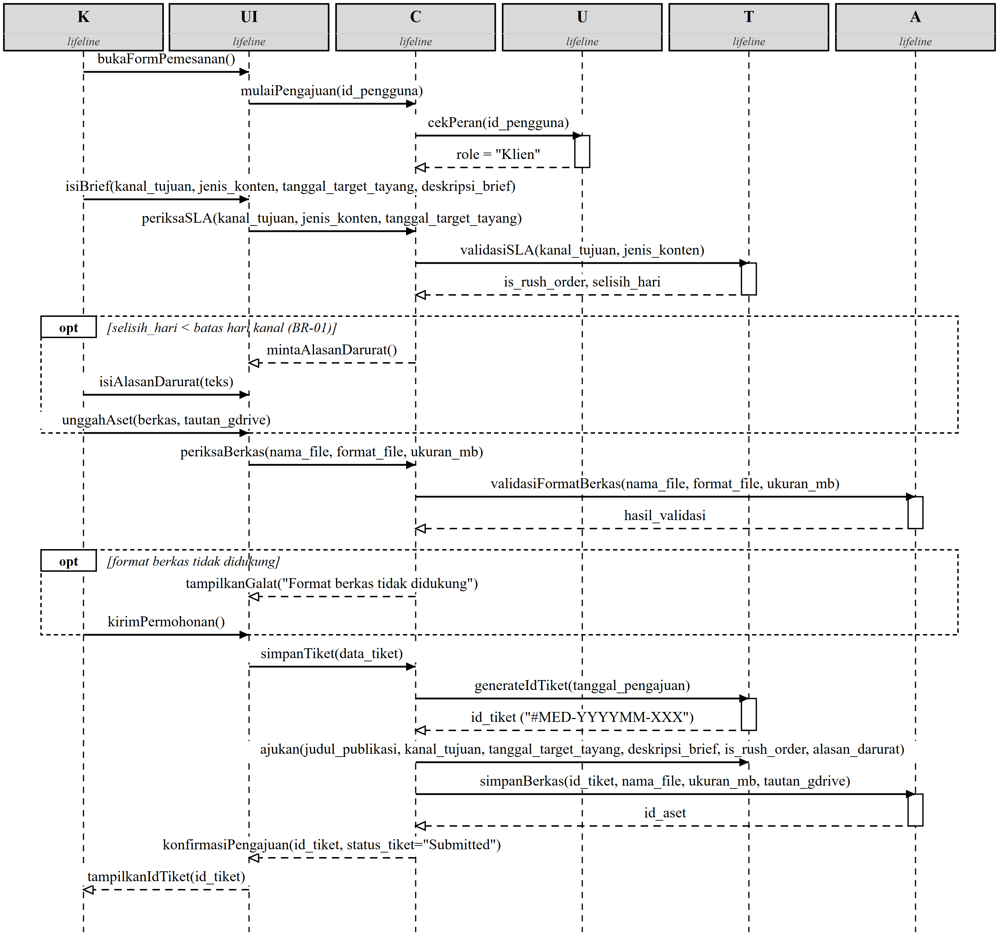

**Tabel 3.2 Spesifikasi Skenario Interaksi Operasional SD-01: Pengajuan Tiket Request Konten**

| Elemen Skenario | Spesifikasi Teknis & Operasional Kelompok |
|---|---|
| ID Interaksi & Use Case | SD-01 — Merealisasikan UC-01: Pengajuan Tiket Request Konten |
| Kebutuhan & Kriteria Terkait | FR-02 (formulir multi-kanal), FR-03 (validasi SLA dan Rush Order), FR-04 (unggah aset), BR-01 (batas H-4/H-5/H-7), BR-05 (retensi aset), AC-03, AC-04, AC-05 |
| Partisipan / Lifeline Terlibat | 1. `:Klien` (Actor); 2. `:FormPemesananUI` (`«boundary»`); 3. `:PengajuanController` (`«control»`); 4. `:PENGGUNA` (`«entity»`); 5. `:TIKET_PESANAN` (`«entity»`); 6. `:BERKAS_ASET` (`«entity»`) |
| Precondition (Kondisi Prasyarat) | Klien telah terautentikasi (FR-01) dan data master KEMENTERIAN serta akun Klien tersedia; tiket belum melewati batas maksimal aset per tiket. |
| Trigger (Pemicu Interaksi) | Klien memilih menu "Buat Pesanan Konten Baru" pada dasbor Klien. |
| Main Flow (Alur Normal / Sukses) | Langkah 1: `:Klien` memicu pesan 1 `bukaFormPemesanan()` pada `:FormPemesananUI`. Langkah 2–4: `:PengajuanController` memverifikasi peran pemanggil melalui 3 `cekPeran(id_pengguna)` pada `:PENGGUNA` dan menerima 4 `role = "Klien"`. Langkah 5–8: Klien mengisi kanal, jenis konten, tanggal target tayang, dan brief (pesan 5); `:PengajuanController` menerima 6 `periksaSLA(kanal_tujuan, jenis_konten, tanggal_target_tayang)`, memanggil 7 `validasiSLA(kanal_tujuan, jenis_konten)` pada `:TIKET_PESANAN`, dan menerima 8 `is_rush_order` beserta selisih hari. Langkah 11–14: Klien mengunggah aset; controller meminta 13 `validasiFormatBerkas(nama_file, format_file, ukuran_mb)` pada `:BERKAS_ASET`. Langkah 16–22: pada `kirimPermohonan()`, controller membangkitkan `id_tiket` (18–19), memanggil 20 `ajukan(judul_publikasi, kanal_tujuan, jenis_konten, tanggal_target_tayang, deskripsi_brief, is_rush_order, alasan_darurat)` pada `:TIKET_PESANAN`, dan 21 `simpanBerkas(...)` pada `:BERKAS_ASET`. Langkah 23–24: `:FormPemesananUI` merender konfirmasi berisi ID tiket dan status `Submitted` ke Klien. |
| Alternate Flow (Alur Alternatif) | Kondisi selisih hari kurang dari batas kanal (BR-01) — direalisasikan sebagai combined fragment `opt` karena hanya berlaku satu arah: Langkah 9a: `:PengajuanController` memanggil `mintaAlasanDarurat()` dan `:FormPemesananUI` membuka kolom alasan darurat. Langkah 10a: Klien mengisi `isiAlasanDarurat(teks)`; tiket diberi `is_rush_order = true` dan alur kembali ke langkah 11. |
| Exception Flow (Alur Eksepsi / Gagal) | Kondisi format/ukuran berkas tidak didukung atau berkas > 50 MB tanpa tautan Google Drive (BR-05): Langkah 15b: `:PengajuanController` mendeteksi kegagalan validasi, membatalkan penyimpanan berkas, dan mengembalikan pesan kesalahan. Langkah 15c: `:FormPemesananUI` menampilkan pesan "Format berkas tidak didukung. Unggah berkas valid atau cantumkan tautan Google Drive"; alur kembali ke langkah 11 tanpa membuat tiket. |
| Postcondition (Kondisi Akhir) | Satu baris `TIKET_PESANAN` baru tersimpan dengan `status_tiket = Submitted` (atau `Submitted` + `is_rush_order = true`), baris `BERKAS_ASET` terkait tersimpan dengan `status_purge = false`, dan tiket muncul pada antrean verifikasi Admin. |

## 3.3 Sequence Diagram SD-02: Validasi dan Penugasan Tiket Konten

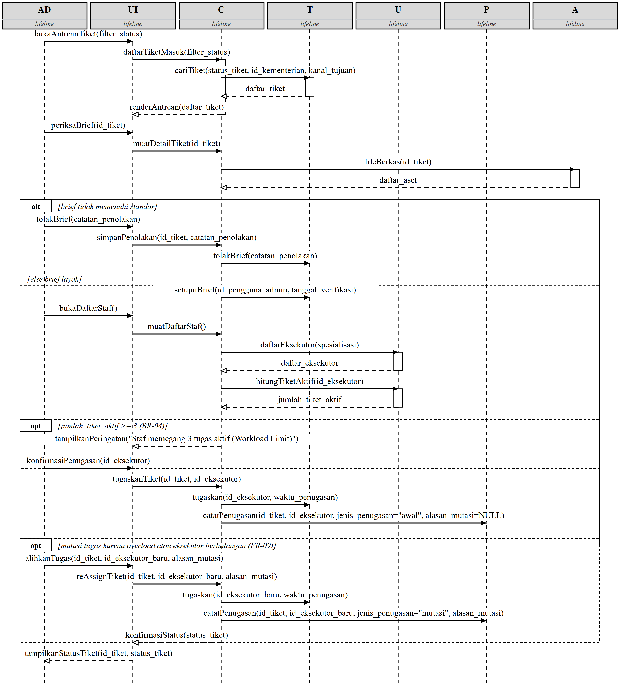

**Tabel 3.3 Spesifikasi Skenario Interaksi Operasional SD-02: Validasi dan Penugasan Tiket Konten**

| Elemen Skenario | Spesifikasi Teknis & Operasional Kelompok |
|---|---|
| ID Interaksi & Use Case | SD-02 — Merealisasikan UC-02: Validasi dan Penugasan Tiket Konten |
| Kebutuhan & Kriteria Terkait | FR-06 (antrean tiket Admin), FR-07 (approve/reject brief), FR-08 (penugasan + indikator beban), FR-09 (re-assign), BR-03 (otoritas Admin), BR-04 (maksimal 3 tiket aktif), NFR-SEC-02 (RBAC), AC-07, AC-08, AC-09, AC-10, AC-11 |
| Partisipan / Lifeline Terlibat | 1. `:Admin` (Actor); 2. `:DashboardAdminUI` (`«boundary»`); 3. `:DisposisiController` (`«control»`); 4. `:TIKET_PESANAN` (`«entity»`); 5. `:PENGGUNA` (`«entity»`); 6. `:RIWAYAT_PENUGASAN` (`«entity»`); 7. `:BERKAS_ASET` (`«entity»`) |
| Precondition (Kondisi Prasyarat) | Minimal satu tiket berstatus `Submitted` berada dalam antrean; Admin terautentikasi dengan peran yang berhak menetapkan penugasan (BR-03). |
| Trigger (Pemicu Interaksi) | Admin membuka detail tiket baru pada dasbor manajerial. |
| Main Flow (Alur Normal / Sukses) | Langkah 1–5: `:DashboardAdminUI` meminta 2 `daftarTiketMasuk(filter_status)`; `:DisposisiController` memanggil 3 `cariTiket(status_tiket, id_kementerian, kanal_tujuan)` pada `:TIKET_PESANAN` dan merender antrean. Langkah 6–9: Admin memeriksa brief; controller memuat 8 `fileBerkas(id_tiket)` dari `:BERKAS_ASET`. Langkah 13: controller memanggil 13 `setujuiBrief(id_pengguna_admin, tanggal_verifikasi)`. Langkah 14–20: `:DisposisiController` memuat 16 `daftarEksekutor(spesialisasi)` dari `:PENGGUNA` dan menghitung beban kerja melalui 18 `hitungTiketAktif(id_eksekutor)` pada `:PENGGUNA`. Langkah 21–24: penugasan dikonfirmasi, `:TIKET_PESANAN` mencatat 23 `tugaskan(id_eksekutor, waktu_penugasan)` dan `:RIWAYAT_PENUGASAN` mencatat 24 `catatPenugasan(..., jenis_penugasan="awal")`. Langkah 29–30: status `Assigned` dirender ke Admin. |
| Alternate Flow (Alur Alternatif) | Kondisi brief tidak memenuhi standar: Langkah 10a: Admin menekan "Tolak/Revisi Brief" pada `:DashboardAdminUI`. Langkah 11a: `simpanPenolakan(id_tiket, catatan_penolakan)` diteruskan ke controller. Langkah 12a: `:TIKET_PESANAN` mengeksekusi `tolakBrief(catatan_penolakan)` sehingga `status_tiket = Rejected` atau `Revision Required` dan catatan alasan tersimpan untuk dibaca Klien. |
| Exception Flow (Alur Eksepsi / Gagal) | Kondisi calon eksekutor telah memegang 3 tiket aktif berstatus `In Progress` (BR-04): Langkah 20b: `:DisposisiController` menahan eksekusi penugasan dan mengembalikan peringatan batas beban kerja. Langkah 20c: `:DashboardAdminUI` menampilkan dialog "Staf tersebut telah memegang 3 tugas aktif (Workload Limit). Lanjutkan?"; Admin dapat membatalkan dan memilih staf lain, atau melanjutkan dengan konfirmasi manajerial khusus. Kondisi Admin memilih staf yang tidak berwenang/berhalangan: penugasan ditolak oleh `tugaskan()` dengan pesan galat peran (NFR-SEC-02). |
| Postcondition (Kondisi Akhir) | `TIKET_PESANAN.status_tiket` bernilai `Assigned` (atau `Rejected`/`Revision Required` pada jalur alternatif), `id_eksekutor` dan `waktu_penugasan` terisi, dan satu baris `RIWAYAT_PENUGASAN` tercatat sebagai jejak penugasan awal maupun mutasi. |

## 3.4 Sequence Diagram SD-03: Pengerjaan dan Unggah Draf Karya

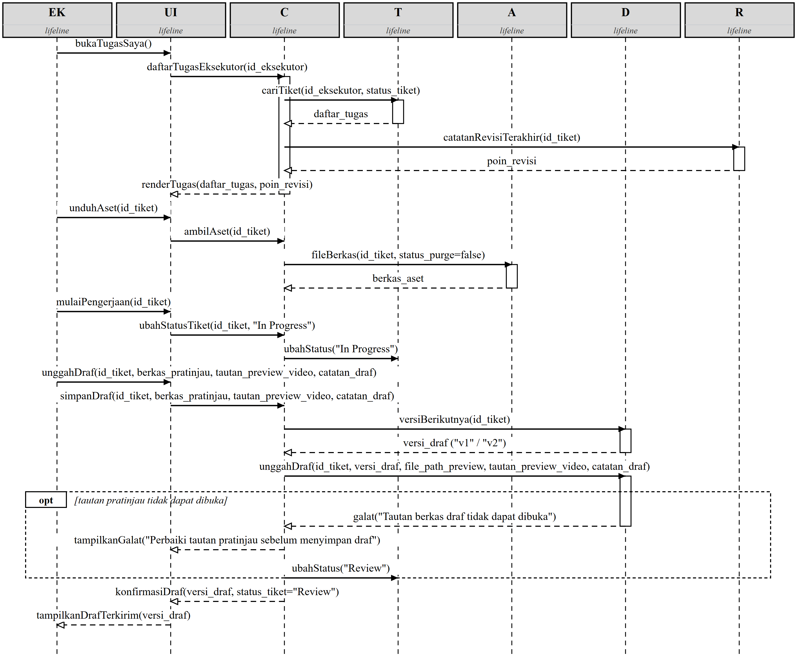

**Tabel 3.4 Spesifikasi Skenario Interaksi Operasional SD-03: Pengerjaan dan Unggah Draf Karya**

| Elemen Skenario | Spesifikasi Teknis & Operasional Kelompok |
|---|---|
| ID Interaksi & Use Case | SD-03 — Merealisasikan UC-03: Pengerjaan dan Unggah Draf Karya |
| Kebutuhan & Kriteria Terkait | FR-10 (daftar tugas pribadi), FR-11 (pembaruan status dan unggah draf v1/v2), BR-04 (batas beban aktif), NFR-PERF-01, AC-12, AC-13 |
| Partisipan / Lifeline Terlibat | 1. `:Eksekutor` (Actor); 2. `:DashboardEksekutorUI` (`«boundary»`); 3. `:ProduksiController` (`«control»`); 4. `:TIKET_PESANAN` (`«entity»`); 5. `:BERKAS_ASET` (`«entity»`); 6. `:DRAF_KARYA` (`«entity»`); 7. `:RIWAYAT_REVISI` (`«entity»`) |
| Precondition (Kondisi Prasyarat) | Tiket telah didelegasikan kepada Eksekutor dengan `status_tiket ∈ {Assigned, In Progress, Revision}` dan `id_eksekutor` sesuai akun yang login. |
| Trigger (Pemicu Interaksi) | Eksekutor membuka halaman "Tugas Saya" dan memilih tiket terkait. |
| Main Flow (Alur Normal / Sukses) | Langkah 1–7: `:DashboardEksekutorUI` meminta 2 `daftarTugasEksekutor(id_eksekutor)`; `:ProduksiController` memanggil 3 `cariTiket(id_eksekutor, status_tiket)` pada `:TIKET_PESANAN` dan 5 `catatanRevisiTerakhir(id_tiket)` pada `:RIWAYAT_REVISI`, lalu merender daftar tugas beserta catatan revisi terakhir. Langkah 8–11: aset diambil dari `:BERKAS_ASET` melalui 10 `fileBerkas(id_tiket, status_purge=false)`. Langkah 12–14: tombol "Mulai Pengerjaan" memicu 14 `ubahStatus("In Progress")`. Langkah 15–19: draf diunggah; controller meminta 17 `versiBerikutnya(id_tiket)` untuk memperoleh nomor versi dan menyimpannya melalui 19 `unggahDraf(...)`. Langkah 22–24: `:TIKET_PESANAN` mencatat 22 `ubahStatus("Review")` dan konfirmasi versi draf dirender ke Eksekutor. |
| Alternate Flow (Alur Alternatif) | Kondisi tiket berstatus `Revision` dan Eksekutor mengunggah draf perbaikan: Langkah 17a: `versiBerikutnya(id_tiket)` mengembalikan versi berikutnya (v1 → v2) berdasarkan `DRAF_KARYA.versi_draf` tertinggi. Langkah 19a: draf v2 tersimpan sebagai baris baru, bukan menimpa draf v1, sehingga riwayat revisi tetap dapat diaudit. Langkah 22a: status tiket dikembalikan ke `Review`. |
| Exception Flow (Alur Eksepsi / Gagal) | Kondisi tautan pratinjau video tidak valid atau berkas pratinjau gagal dibaca: Langkah 20b: `:DRAF_KARYA` mengembalikan galat dan `:ProduksiController` membatalkan transaksi penyimpanan draf sehingga status tiket tetap `In Progress`. Langkah 21b: `:DashboardEksekutorUI` menampilkan pesan "Perbaiki tautan pratinjau sebelum menyimpan draf"; Eksekutor mengulang langkah 15. |
| Postcondition (Kondisi Akhir) | Satu baris `DRAF_KARYA` baru tersimpan dengan `versi_draf` berurutan dan `file_path_preview` terisi, serta `TIKET_PESANAN.status_tiket` bernilai `Review` sehingga draf siap ditinjau Klien. |

## 3.5 Sequence Diagram SD-04: Tinjauan Draf, Persetujuan Akhir, dan Publikasi

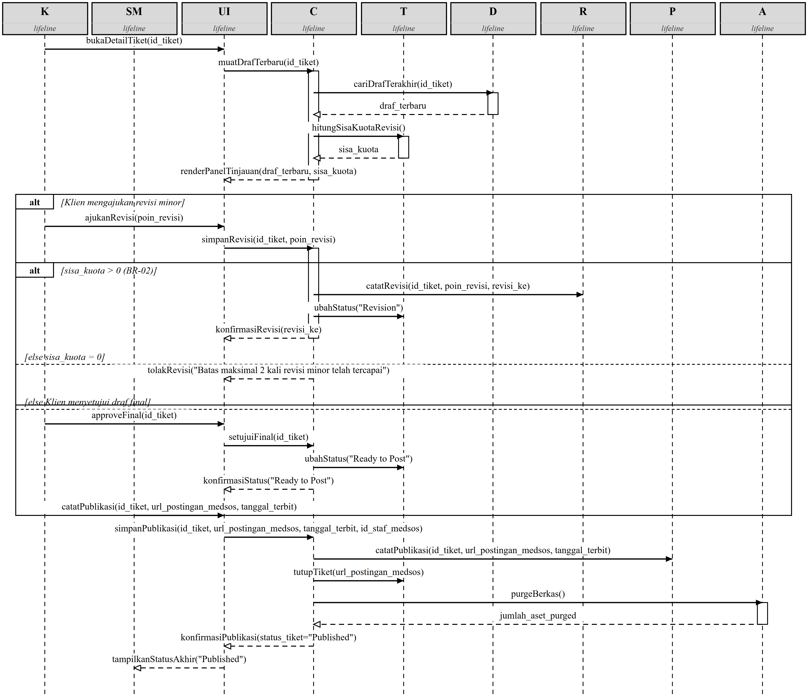

**Tabel 3.5 Spesifikasi Skenario Interaksi Operasional SD-04: Tinjauan Draf, Persetujuan Akhir, dan Publikasi**

| Elemen Skenario | Spesifikasi Teknis & Operasional Kelompok |
|---|---|
| ID Interaksi & Use Case | SD-04 — Merealisasikan UC-04: Tinjauan Draf, Persetujuan Akhir, dan Publikasi |
| Kebutuhan & Kriteria Terkait | FR-05 (pemantauan status tiket), FR-12 (kuota revisi maksimal 2), FR-13 (persetujuan final), FR-14 (kalender editorial), FR-15 (tautan publikasi + auto-purge), BR-02, BR-05, NFR-PERF-01, AC-06, AC-14, AC-15, AC-16, AC-17, AC-18 |
| Partisipan / Lifeline Terlibat | 1. `:Klien` (Actor); 2. `:Staf Medsos` (Actor); 3. `:PanelReviewKlienUI` (`«boundary»`); 4. `:ReviewPublikasiController` (`«control»`); 5. `:TIKET_PESANAN` (`«entity»`); 6. `:DRAF_KARYA` (`«entity»`); 7. `:RIWAYAT_REVISI` (`«entity»`); 8. `:PUBLIKASI_KONTEN` (`«entity»`); 9. `:BERKAS_ASET` (`«entity»`) |
| Precondition (Kondisi Prasyarat) | `TIKET_PESANAN.status_tiket = Review` dan minimal satu baris `DRAF_KARYA` tersedia untuk tiket tersebut. |
| Trigger (Pemicu Interaksi) | Klien membuka notifikasi peninjauan hasil karya pada dasbor Klien. |
| Main Flow (Alur Normal / Sukses) | Langkah 1–7: `:PanelReviewKlienUI` meminta 2 `muatDrafTerbaru(id_tiket)`; `:ReviewPublikasiController` memanggil 3 `cariDrafTerakhir(id_tiket)` pada `:DRAF_KARYA` dan 5 `hitungSisaKuotaRevisi()` pada `:TIKET_PESANAN` sebelum merender panel tinjauan. Langkah 14–17: Klien menekan "Setujui Karya (Final Approve)"; controller mengeksekusi 16 `ubahStatus("Ready to Post")`. Langkah 18–24: Staf Medsos menyematkan tautan tayang riil; controller mencatat 20 `catatPublikasi(...)` pada `:PUBLIKASI_KONTEN`, menutup tiket melalui 21 `tutupTiket(url_postingan_medsos)`, dan menjalankan 22 `purgeBerkas()` pada `:BERKAS_ASET` sesuai BR-05. Langkah 25: status akhir `Published` ditampilkan ke Staf Medsos. |
| Alternate Flow (Alur Alternatif) | Kondisi Klien menemukan kekeliruan minor dan menekan "Ajukan Revisi": Langkah 8a: Klien mengirim `ajukanRevisi(poin_revisi)`. Langkah 10a: setelah `hitungSisaKuotaRevisi` menunjukkan sisa kuota > 0, `:RIWAYAT_REVISI` menyimpan baris baru melalui `catatRevisi(id_tiket, poin_revisi, revisi_ke)` (BR-02). Langkah 11a: `:TIKET_PESANAN` mengubah status menjadi `Revision` sehingga tugas kembali ke dasbor Eksekutor. |
| Exception Flow (Alur Eksepsi / Gagal) | Kondisi kuota revisi telah terpakai 2 kali: Langkah 13b: `:ReviewPublikasiController` menolak penyimpanan revisi, membatalkan perubahan status, dan mengembalikan pesan penolakan. Langkah 13c: `:PanelReviewKlienUI` menonaktifkan tombol pengajuan revisi dan menampilkan "Batas maksimal 2 kali revisi minor telah tercapai. Hubungi Admin Medkreminfo untuk mediasi lebih lanjut". Kondisi tautan publikasi kosong saat penutupan tiket: `tutupTiket()` menolak transisi ke `Published` karena `url_postingan_medsos` wajib terisi (IC-09). |
| Postcondition (Kondisi Akhir) | Tiket berstatus `Published` dengan satu baris `PUBLIKASI_KONTEN` berisi `url_postingan_medsos` dan `tanggal_terbit`; seluruh baris `BERKAS_ASET` tiket tersebut memiliki `status_purge = true` dan `file_path` dikosongkan, sementara metadata ukuran, format, dan tautan tetap tersimpan (BR-05). |

---

# 4. Entity Relationship Diagram (ERD) dan Model Data

## 4.1 Model Data Konseptual: Keputusan Entitas, ERD Konseptual, dan Matriks Relasi

### Tabel 4.1a Keputusan Entitas (Kandidat yang Diterima dan Ditolak)

| Kandidat (Istilah SRS) | Keputusan | Alasan | Sumber (FR/BR) |
|---|---|---|---|
| Kementerian pemesan | Entitas `KEMENTERIAN` | Punya identitas sendiri (kode kementerian), dan 14 kementerian berbeda saling memisahkan kepemilikan data tiket. | SRS §1.2, NFR-SEC-02, W01 |
| Klien / Eksekutor / Admin / Staf Medsos | Entitas `PENGGUNA` | Satu tabel akun dengan kolom peran; menyimpan data bisnis (nama kontak, nomor WhatsApp, spesialisasi) yang dipakai lintas use case. | FR-01, FR-16, NFR-SEC-02 |
| Tiket / data tiket | Entitas `TIKET_PESANAN` | Objek transaksional utama yang statusnya berubah dari pengajuan sampai tayang. | FR-02, FR-05, FR-11 |
| Berkas materi / aset pendukung | Entitas `BERKAS_ASET` | Satu tiket bisa memuat banyak berkas, dan tiap berkas punya status retensi sendiri (auto-purge), sehingga tidak bisa menjadi satu kolom di tiket. | FR-04, BR-05 |
| Draf karya v1/v2 | Entitas `DRAF_KARYA` | Riwayat versi draf harus tetap tersimpan walau draf baru diunggah; nomor versi bertambah tiap unggahan. | FR-11, AC-13 |
| Poin revisi dari Klien | Entitas `RIWAYAT_REVISI` | Kuota revisi dihitung dari jumlah baris catatan revisi per tiket, dan tiap poin revisi punya waktu pengajuan sendiri. | FR-12, BR-02 |
| Tautan tayang riil | Entitas `PUBLIKASI_KONTEN` | Dipisah dari tiket agar waktu siar aktual dan staf medsos pelaksana terpisah dari alur produksi internal. | FR-15, OP-02 |
| Riwayat mutasi penanggung jawab | Entitas `RIWAYAT_PENUGASAN` | AC-11 menuntut riwayat mutasi tercatat; satu kolom `id_eksekutor` pada tiket hanya menyimpan penanggung jawab terakhir. | FR-09, AC-11 |
| ID tiket (`#MED-YYYYMM-XXX`) | Atribut `TIKET_PESANAN.id_tiket` | Kunci utama penanda unik, tidak punya identitas sendiri di luar tiketnya. | FR-02, AC-03 |
| Selisih hari / validasi SLA | Bukan entitas | Nilai hitungan saat pengajuan (tanggal target dikurangi tanggal pengajuan) yang tidak perlu disimpan; yang disimpan adalah akibatnya yaitu `is_rush_order`. | BR-01, FR-03 |
| Kuota revisi terpakai | Bukan entitas | Nilai turunan dari jumlah baris `RIWAYAT_REVISI`; disimpan sebagai kolom justru berisiko tidak sinkron. | BR-02, FR-12 |
| Halaman formulir pemesanan, tombol kirim, pesan galat | Bukan entitas | Elemen antarmuka dan pesan sekali lewat; tidak ada data yang disimpan ke basis data. | FR-02, FR-04 |
| Notifikasi konfirmasi status tiket | Bukan entitas | Pemberitahuan status; pada SRS v1.0 mekanisme notifikasi masih berstatus TBD-01 (belum ditetapkan kanal pengirimnya), jadi belum dimodelkan sebagai tabel. | TBD-01, FR-05 |
| Kategori/kalender editorial | Bukan entitas | Kalender adalah tampilan turunan (view) dari `tanggal_target_tayang` dan `tanggal_terbit`, bukan data yang diinput terpisah. | FR-14, AC-17 |

### ERD Konseptual (Crow's Foot, tanpa FK)

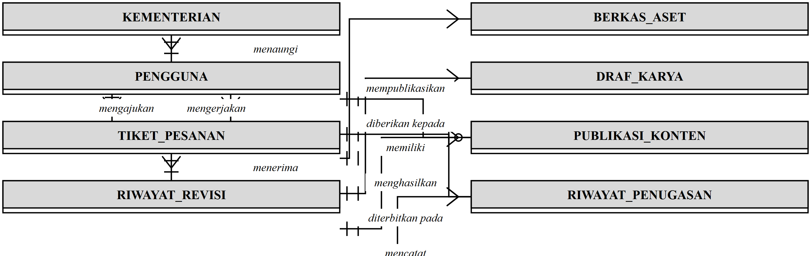

### Tabel 4.1b Matriks Relasi dan Kardinalitas

| Entitas Asal (Parent) | Kata Kerja Relasi | Entitas Tujuan (Child) | Kardinalitas (min..maks, Asal : Tujuan) | Sumber BR/FR dan Rasional Bisnis |
|---|---|---|---|---|
| KEMENTERIAN | menaungi | PENGGUNA | 1..1 : 0..N | NFR-SEC-02. Tiap akun perwakilan wajib milik tepat satu kementerian; satu kementerian dapat memiliki banyak akun pengurus. |
| PENGGUNA | mengajukan | TIKET_PESANAN | 1..1 : 0..N | FR-02, FR-05. Satu akun Klien membuat 0 atau banyak tiket; setiap tiket wajib dibuat tepat 1 Klien (`id_pemohon`). |
| PENGGUNA | mengerjakan | TIKET_PESANAN | 0..1 : 0..N | FR-08, BR-04. Eksekutor hanya menangani tiket yang ditugaskan Admin; saat tiket baru diajukan belum ada eksekutor (0..1); satu eksekutor menangani banyak tiket selama tiket aktifnya tidak lebih dari 3. |
| TIKET_PESANAN | memiliki | BERKAS_ASET | 1..1 : 0..N | FR-04, BR-05. Berkas aset wajib terikat ke satu tiket; satu tiket dapat memiliki banyak berkas dengan masa simpan sampai tiket `Published`. |
| TIKET_PESANAN | menghasilkan | DRAF_KARYA | 1..1 : 0..N | FR-11, AC-13. Tiap unggahan draf menjadi baris baru dengan nomor versi bertambah; tiket yang belum dikerjakan belum punya draf. |
| TIKET_PESANAN | menerima | RIWAYAT_REVISI | 1..1 : 0..N | FR-12, BR-02. Relasi M:N antara tiket dan poin revisi dipecah menjadi entitas anak; jumlah barisnya dibatasi maksimal 2 per tiket. |
| TIKET_PESANAN | diterbitkan pada | PUBLIKASI_KONTEN | 1..1 : 0..1 | FR-15. Satu tiket berpasangan tepat dengan satu catatan publikasi; tiket yang belum tayang belum punya catatan publikasi. |
| PENGGUNA | mempublikasikan | PUBLIKASI_KONTEN | 1..1 : 0..N | FR-15, OP-02. Satu staf publikasi dapat mencatatkan banyak tautan tayang dari kementerian berbeda; setiap catatan publikasi wajib menunjuk satu staf pelaksana. |
| TIKET_PESANAN | mencatat | RIWAYAT_PENUGASAN | 1..1 : 0..N | FR-08, FR-09, AC-11. Setiap penugasan awal dan mutasi menjadi satu baris jejak; tiket baru tanpa penugasan belum punya baris riwayat. |
| PENGGUNA | diberikan kepada | RIWAYAT_PENUGASAN | 1..1 : 0..N | FR-09, AC-11. Setiap baris riwayat menunjuk satu eksekutor penerima tugas; satu eksekutor dapat menerima banyak penugasan sepanjang periode kepengurusan. |

## 4.2 Entity Relationship Diagram (ERD) — Model Data Logis (3NF)

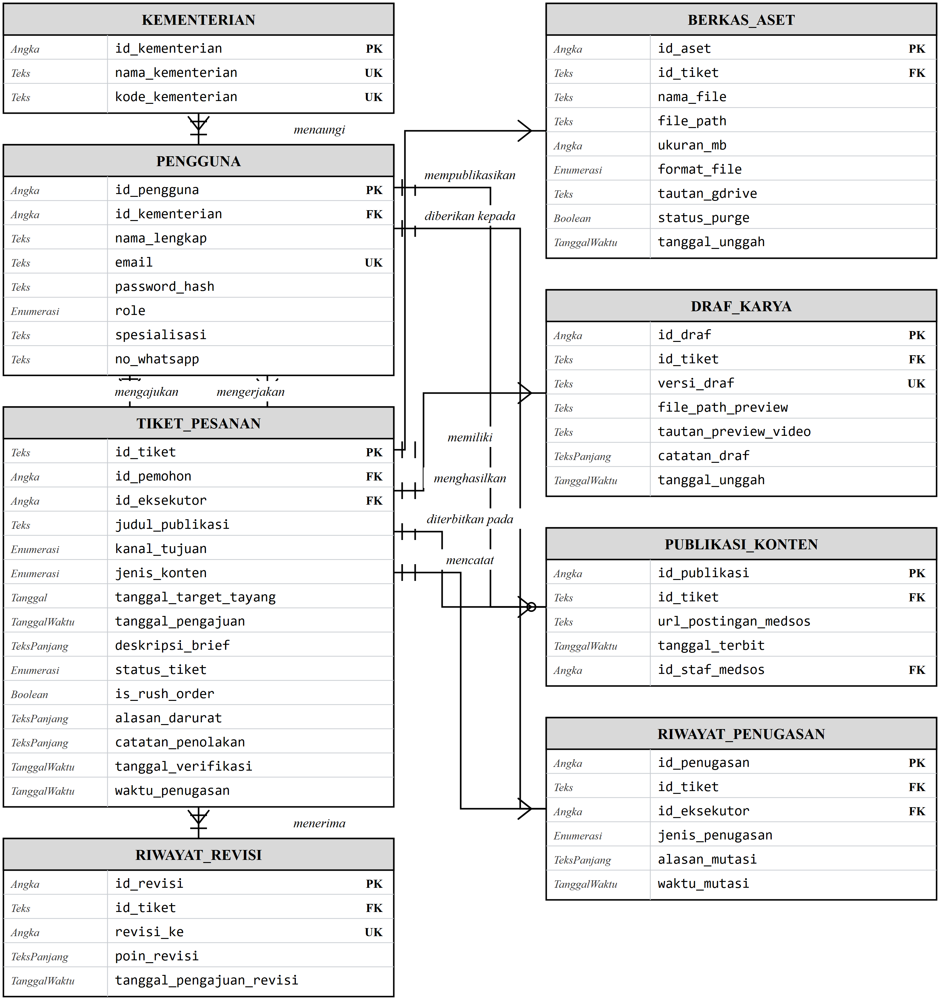

Keterangan penanda: `PK` = kunci utama; `FK` = kunci tamu, atribut yang boleh kosong ditandai pada kamus data Bab 5.1 kolom "Wajib" dengan nilai Tidak/Bersyarat; `UK` = kunci unik bisnis. Kunci unik gabungan: `DRAF_KARYA (id_tiket, versi_draf)` dan `RIWAYAT_REVISI (id_tiket, revisi_ke)`; kunci unik tunggal: `PENGGUNA.email`, `PUBLIKASI_KONTEN.id_tiket`, `KEMENTERIAN.nama_kementerian`, `KEMENTERIAN.kode_kementerian`.

**Evaluasi Kepatuhan Bentuk Normalisasi (3NF):**
1. **Kepatuhan 1NF (First Normal Form):** Seluruh atribut bernilai atomik. Daftar kanal dan daftar aset tidak disimpan sebagai kolom bertanda pemisah, melainkan dipecah menjadi baris `BERKAS_ASET` dan satu nilai `kanal_tujuan` per tiket.
2. **Kepatuhan 2NF (Second Normal Form):** Seluruh atribut non-kunci bergantung pada seluruh Primary Key tabelnya. Pada entitas ber-kunci komposit tidak ada tabel ber-PK komposit tersisa karena `DRAF_KARYA` dan `RIWAYAT_REVISI` diberi PK tunggal (`id_draf`, `id_revisi`) dengan UK gabungan, sehingga tidak mungkin ada ketergantungan parsial.
3. **Kepatuhan 3NF (Third Normal Form):** Tidak ada ketergantungan transitif antar-atribut non-kunci. Dua calon pelanggaran sudah ditangani: (a) `nama_kementerian` tidak disimpan di `PENGGUNA` melainkan direferensikan lewat `id_kementerian`; (b) `kuota_revisi_terpakai` tidak disimpan di `TIKET_PESANAN` melainkan dihitung dari jumlah baris `RIWAYAT_REVISI` (lihat Tabel 4.2 dan operasi `hitungSisaKuotaRevisi()` pada Bab 6.2).

### Tabel 4.2 Bukti Normalisasi dan Keputusan Atribut per Entitas

| Entitas | Primary Key | Hasil Uji 1NF, 2NF, 3NF | Keputusan Atribut (Disimpan / Dipecah / Dihitung) | Alasan dan Sumber |
|---|---|---|---|---|
| KEMENTERIAN | id_kementerian (tunggal) | 1NF: atomik. 2NF: PK tunggal. 3NF: tidak ada ketergantungan transitif. | Disimpan: nama_kementerian, kode_kementerian. | Nama dan kode kementerian dipakai berulang di halaman Klien maupun Admin, jadi disimpan sekali sebagai data referensi (FR-05, FR-06). |
| PENGGUNA | id_pengguna (tunggal) | 1NF: atomik. 2NF: PK tunggal. 3NF: nama_kementerian tidak disimpan di sini, hanya `id_kementerian`. | Disimpan: email, password_hash, role, no_whatsapp, spesialisasi. Tidak disimpan: nama_kementerian (FK menuju KEMENTERIAN). `spesialisasi` boleh kosong untuk peran Klien. | FR-01, FR-16, NFR-SEC-01. Menyimpan nama kementerian di dua tabel akan membuat dua sumber kebenaran yang bisa berbeda (pelanggaran 3NF). |
| TIKET_PESANAN | id_tiket (tunggal) | 1NF: atomik. 2NF: PK tunggal. 3NF: tidak ada ketergantungan transitif. | Disimpan: judul_publikasi, kanal_tujuan, jenis_konten, tanggal_target_tayang, tanggal_pengajuan, deskripsi_brief, status_tiket, is_rush_order, alasan_darurat, catatan_penolakan, tanggal_verifikasi, waktu_penugasan. `/kuota_revisi_terpakai` dihitung, tidak disimpan. `/selisih_hari` dihitung, tidak disimpan. | BR-01, BR-02, FR-03, FR-12. `is_rush_order` adalah akibat keputusan bisnis yang perlu dibaca berulang, jadi nilainya disimpan; selisih harinya sendiri tidak. |
| BERKAS_ASET | id_aset (tunggal) | 1NF: atomik. 2NF: PK tunggal. 3NF: ukuran dan format bergantung pada berkas, bukan pada tiket. | Disimpan: nama_file, file_path, ukuran_mb, format_file, tautan_gdrive, status_purge, tanggal_unggah. | FR-04, BR-05. `status_purge` perlu disimpan agar auto-purge tidak menghapus metadata tiket dan tautan tayang. |
| DRAF_KARYA | id_draf (tunggal); UK (id_tiket, versi_draf) | 1NF: atomik. 2NF: tidak ada ketergantungan parsial karena PK tunggal. 3NF: nomor versi hanya bergantung pada pasangan tiket dan urutan unggahan. | Disimpan: versi_draf, file_path_preview, tautan_preview_video, catatan_draf, tanggal_unggah. | FR-11, AC-13. Draf lama tidak ditimpa agar riwayat versi tetap dapat diaudit. |
| RIWAYAT_REVISI | id_revisi (tunggal); UK (id_tiket, revisi_ke) | 1NF: atomik. 2NF: tidak ada ketergantungan parsial. 3NF: `revisi_ke` bergantung pada nomor urut revisi tiket, bukan pada atribut non-kunci lain. | Disimpan: revisi_ke, poin_revisi, tanggal_pengajuan_revisi. | FR-12, BR-02. Pembatasan kuota 2 kali ditegakkan dengan menghitung baris, bukan dengan kolom penghitung. |
| PUBLIKASI_KONTEN | id_publikasi (tunggal); UK id_tiket | 1NF: atomik. 2NF: PK tunggal. 3NF: waktu tayang bergantung pada publikasi, bukan pada tiket. | Disimpan: url_postingan_medsos, tanggal_terbit. FK: id_tiket, id_staf_medsos. | FR-15, AC-18. Tanggal terbit riil dibedakan dari `tanggal_target_tayang` karena jadwal bisa bergeser. |
| RIWAYAT_PENUGASAN | id_penugasan (tunggal) | 1NF: atomik. 2NF: PK tunggal. 3NF: alasan mutasi hanya ada pada baris mutasi. | Disimpan: jenis_penugasan, alasan_mutasi, waktu_mutasi. FK: id_tiket, id_eksekutor. | FR-09, AC-11. Riwayat mutasi penanggung jawab tidak dapat diturunkan dari kolom mana pun pada tiket. |

---

# 5. Data Dictionary dan Integrity Constraints

## 5.1 Kamus Data (Data Dictionary) per Entitas

Tipe ditulis pada tingkat logis. Atribut turunan diawali tanda "/" dan berstatus tidak disimpan.

### Tabel 5.1.1 Struktur Kamus Data: Entitas KEMENTERIAN

| Atribut | Definisi Bisnis | Tipe & Format | Domain / Aturan | Wajib | Key | Sumber (FR/BR/IC) |
|---|---|---|---|---|---|---|
| id_kementerian | Nomor unik penanda kementerian di lingkungan BEM FT. | Angka | Bilangan bulat positif; unik. | Ya | PK | FR-06, IC-01 |
| nama_kementerian | Nama resmi kementerian, mis. Kementerian Media, Kreatif, dan Informasi. | Teks(80) | Tidak kosong; unik. | Ya | UK | FR-06, IC-01 |
| kode_kementerian | Singkatan resmi kementerian untuk keperluan penamaan berkas dan tampilan singkat. | Teks(12) | Tidak kosong; unik; huruf kapital/angka. | Ya | UK | FR-02, IC-01 |

### Tabel 5.1.2 Struktur Kamus Data: Entitas PENGGUNA

| Atribut | Definisi Bisnis | Tipe & Format | Domain / Aturan | Wajib | Key | Sumber (FR/BR/IC) |
|---|---|---|---|---|---|---|
| id_pengguna | Nomor unik akun pengguna sistem. | Angka | Bilangan bulat positif; unik. | Ya | PK | FR-01, IC-01 |
| id_kementerian | Kementerian asal akun Klien; kosong untuk akun staf Medkreminfo. | Angka | Harus ada di KEMENTERIAN bila terisi. | Bersyarat | FK | FR-01, NFR-SEC-02, IC-02 |
| nama_lengkap | Nama pengurus penanggung jawab akun. | Teks(80) | Tidak kosong. | Ya | – | FR-01, FR-16 |
| email | Alamat surel untuk login dan kontak resmi. | Teks(80) | Format surel; unik. | Ya | UK | FR-01, AC-01, IC-01 |
| password_hash | Kata sandi akun dalam bentuk hash searah. | Teks(255) | Tidak boleh disimpan sebagai teks asli. | Ya | – | FR-01, NFR-SEC-01 |
| role | Peran pengguna yang menentukan hak akses. | Enumerasi | {Klien, Eksekutor, Admin, Staf Publikasi}; menggerakkan RBAC. | Ya | – | FR-01, NFR-SEC-02, IC-04 |
| spesialisasi | Bidang keahlian staf eksekutor (desain grafis, video, penulisan naskah). | Enumerasi | Wajib bila role = Eksekutor; kosong untuk peran lain. | Bersyarat | – | FR-08, BR-04, IC-09 |
| no_whatsapp | Nomor WhatsApp aktif penanggung jawab untuk kebutuhan konfirmasi. | Teks(15) | Hanya angka dan tanda "+" di awal. | Ya | – | FR-16, W05 |

### Tabel 5.1.3 Struktur Kamus Data: Entitas TIKET_PESANAN

| Atribut | Definisi Bisnis | Tipe & Format | Domain / Aturan | Wajib | Key | Sumber (FR/BR/IC) |
|---|---|---|---|---|---|---|
| id_tiket | Nomor tiket unik yang terbaca manusia. | Teks(15) | Format `#MED-YYYYMM-XXX`; unik. | Ya | PK | FR-02, AC-03, IC-01 |
| id_pemohon | Akun Klien yang mengajukan tiket. | Angka | Harus ada di PENGGUNA dengan role = Klien. | Ya | FK | FR-02, IC-02 |
| id_eksekutor | Akun Eksekutor yang mengerjakan tiket; kosong sebelum ditugaskan. | Angka | Harus ada di PENGGUNA dengan role = Eksekutor bila terisi. | Bersyarat | FK | FR-08, FR-09, IC-02, IC-09 |
| judul_publikasi | Judul atau topik publikasi yang dipesan. | Teks(120) | Tidak kosong. | Ya | – | FR-02 |
| kanal_tujuan | Media sosial tujuan tayang. | Enumerasi | {Instagram Feeds, Instagram Story, LinkedIn, TikTok}; 4 kanal resmi sesuai Project Charter §1.0. | Ya | – | FR-02, W06, IC-03 |
| jenis_konten | Bentuk materi yang dipesan; menentukan batas hari SLA bersama kanal. | Enumerasi | {Poster, Carousel, Video, Siaran Pers}. | Ya | – | FR-02, BR-01, IC-03, IC-07 |
| tanggal_target_tayang | Tanggal yang diharapkan Klien untuk penayangan konten. | Tanggal | Tidak boleh sebelum tanggal pengajuan. | Ya | – | FR-03, IC-07 |
| tanggal_pengajuan | Waktu tiket dibuat dan tersimpan berstatus `Submitted`. | Tanggal-waktu | Terisi otomatis saat pengajuan; tidak dapat diubah pengguna. | Ya | – | FR-02, BR-01 |
| deskripsi_brief | Arahan konsep, naskah, dan preferensi visual dari Klien. | Teks panjang | Minimal 20 karakter. | Ya | – | FR-02, AC-03 |
| status_tiket | Status tahapan siklus hidup tiket. | Enumerasi | {Submitted, Rejected, Revision Required, Assigned, In Progress, Review, Revision, Ready to Post, Published}; berubah mengikuti IC-10. | Ya | – | FR-05, FR-07, FR-11, FR-12, FR-13, FR-15, IC-04, IC-10 |
| is_rush_order | Penanda tiket diajukan di bawah batas hari SLA. | Boolean | true bila selisih hari kurang dari batas kanal. | Ya | – | FR-03, BR-01, IC-07 |
| alasan_darurat | Justifikasi darurat dari Klien untuk permohonan di bawah SLA. | Teks panjang | Wajib bila is_rush_order = true. | Bersyarat | – | FR-03, BR-01, IC-09 |
| catatan_penolakan | Alasan Admin menolak atau meminta perbaikan brief. | Teks panjang | Wajib bila status_tiket ∈ {Rejected, Revision Required}. | Bersyarat | – | FR-07, AC-08, IC-09 |
| tanggal_verifikasi | Waktu Admin menyetujui atau menolak kelayakan brief. | Tanggal-waktu | Terisi setelah keputusan Admin. | Bersyarat | – | FR-07, AC-08, IC-09 |
| waktu_penugasan | Waktu penugasan terakhir tiket kepada seorang Eksekutor. | Tanggal-waktu | Terisi saat status berubah menjadi `Assigned`. | Bersyarat | – | FR-08, FR-09, IC-09 |
| /kuota_revisi_terpakai | Jumlah siklus revisi minor yang sudah dipakai tiket ini. | Angka | Dihitung: `COUNT(RIWAYAT_REVISI WHERE id_tiket = this)`; maksimal 2. | Tidak disimpan | – | FR-12, BR-02, IC-06 |
| /selisih_hari | Jarak hari antara tanggal pengajuan dan tanggal target tayang. | Angka | Dihitung: `tanggal_target_tayang - tanggal_pengajuan` dalam hari. | Tidak disimpan | – | FR-03, BR-01, IC-07 |

### Tabel 5.1.4 Struktur Kamus Data: Entitas BERKAS_ASET

| Atribut | Definisi Bisnis | Tipe & Format | Domain / Aturan | Wajib | Key | Sumber (FR/BR/IC) |
|---|---|---|---|---|---|---|
| id_aset | Nomor unik berkas aset yang diunggah. | Angka | Bilangan bulat positif; unik. | Ya | PK | FR-04, IC-01 |
| id_tiket | Tiket pemilik berkas aset. | Teks(15) | Harus ada di TIKET_PESANAN. | Ya | FK | FR-04, IC-02 |
| nama_file | Nama berkas asli saat diunggah pengguna. | Teks(150) | Tidak kosong. | Ya | – | FR-04 |
| file_path | Lokasi penyimpanan berkas fisik di server. | Teks(255) | Dikosongkan setelah auto-purge (status_purge = true). | Bersyarat | – | FR-04, BR-05, IC-11 |
| ukuran_mb | Ukuran berkas dalam megabita. | Angka | > 0; berkas > 50 MB wajib disertai tautan_gdrive. | Ya | – | FR-04, BR-05, IC-05 |
| format_file | Format/ekstensi berkas aset. | Enumerasi | {PNG, JPG, JPEG, PDF, DOCX, MP4, MOV}. | Ya | – | FR-04, AC-05, IC-03 |
| tautan_gdrive | Tautan penyimpanan awan pengganti untuk berkas berukuran besar. | Teks(255) | Wajib bila ukuran_mb > 50. | Bersyarat | – | FR-04, BR-05, IC-05 |
| status_purge | Penanda berkas fisik sudah dibersihkan dari server. | Boolean | Berubah menjadi true hanya setelah tiket berstatus `Published`. | Ya | – | BR-05, IC-11 |
| tanggal_unggah | Waktu berkas diunggah Klien atau Eksekutor. | Tanggal-waktu | Terisi otomatis. | Ya | – | FR-04 |

### Tabel 5.1.5 Struktur Kamus Data: Entitas DRAF_KARYA

| Atribut | Definisi Bisnis | Tipe & Format | Domain / Aturan | Wajib | Key | Sumber (FR/BR/IC) |
|---|---|---|---|---|---|---|
| id_draf | Nomor unik baris draf karya. | Angka | Bilangan bulat positif; unik. | Ya | PK | FR-11, IC-01 |
| id_tiket | Tiket yang sedang dikerjakan. | Teks(15) | Harus ada di TIKET_PESANAN. | Ya | FK | FR-11, IC-02 |
| versi_draf | Nomor versi draf hasil kerja. | Teks(6) | Format `v1`, `v2`, `v3`, ...; unik per id_tiket. | Ya | UK | FR-11, AC-13, IC-12 |
| file_path_preview | Lokasi berkas pratinjau (gambar) hasil karya. | Teks(255) | Wajib bila tautan_preview_video kosong. | Bersyarat | – | FR-11, IC-09 |
| tautan_preview_video | Tautan pratinjau untuk karya video. | Teks(255) | Wajib bila draf berbentuk video; harus dapat dibuka. | Bersyarat | – | FR-11, AC-13, IC-09 |
| catatan_draf | Catatan Eksekutor mengenai draf yang diunggah. | Teks panjang | Boleh kosong. | Tidak | – | FR-11 |
| tanggal_unggah | Waktu draf diunggah. | Tanggal-waktu | Terisi otomatis. | Ya | – | FR-11 |

### Tabel 5.1.6 Struktur Kamus Data: Entitas RIWAYAT_REVISI

| Atribut | Definisi Bisnis | Tipe & Format | Domain / Aturan | Wajib | Key | Sumber (FR/BR/IC) |
|---|---|---|---|---|---|---|
| id_revisi | Nomor unik catatan revisi. | Angka | Bilangan bulat positif; unik. | Ya | PK | FR-12, IC-01 |
| id_tiket | Tiket yang dimintai revisi. | Teks(15) | Harus ada di TIKET_PESANAN. | Ya | FK | FR-12, IC-02 |
| revisi_ke | Nomor urut siklus revisi pada tiket tersebut. | Angka | {1, 2}; unik per id_tiket; tidak boleh melebihi kuota. | Ya | UK | FR-12, BR-02, IC-06, IC-12 |
| poin_revisi | Daftar perbaikan minor yang diminta Klien. | Teks panjang | Tidak kosong; revisi konsep total ditolak (BR-02). | Ya | – | FR-12, BR-02 |
| tanggal_pengajuan_revisi | Waktu Klien mengirimkan catatan revisi. | Tanggal-waktu | Harus setelah tanggal unggah draf terakhir. | Ya | – | FR-12 |

### Tabel 5.1.7 Struktur Kamus Data: Entitas PUBLIKASI_KONTEN

| Atribut | Definisi Bisnis | Tipe & Format | Domain / Aturan | Wajib | Key | Sumber (FR/BR/IC) |
|---|---|---|---|---|---|---|
| id_publikasi | Nomor unik catatan publikasi. | Angka | Bilangan bulat positif; unik. | Ya | PK | FR-15, IC-01 |
| id_tiket | Tiket yang diterbitkan. | Teks(15) | Harus ada di TIKET_PESANAN; hanya satu catatan publikasi per tiket. | Ya | FK, UK | FR-15, IC-02, IC-12 |
| url_postingan_medsos | Tautan permanen unggahan di media sosial resmi. | Teks(255) | Wajib terisi; harus tautan kanal resmi BEM FT. | Ya | – | FR-15, AC-18, IC-09 |
| tanggal_terbit | Waktu konten benar-benar tayang di media sosial. | Tanggal-waktu | Tidak boleh sebelum tanggal persetujuan final. | Ya | – | FR-15, FR-14, IC-09 |
| id_staf_medsos | Staf publikasi yang mencatatkan tautan tayang. | Angka | Harus ada di PENGGUNA dengan role = Staf Publikasi. | Ya | FK | FR-15, OP-02, IC-02 |

### Tabel 5.1.8 Struktur Kamus Data: Entitas RIWAYAT_PENUGASAN

| Atribut | Definisi Bisnis | Tipe & Format | Domain / Aturan | Wajib | Key | Sumber (FR/BR/IC) |
|---|---|---|---|---|---|---|
| id_penugasan | Nomor unik baris riwayat penugasan. | Angka | Bilangan bulat positif; unik. | Ya | PK | FR-09, IC-01 |
| id_tiket | Tiket yang ditugaskan atau dialihkan. | Teks(15) | Harus ada di TIKET_PESANAN. | Ya | FK | FR-08, IC-02 |
| id_eksekutor | Eksekutor penerima tugas pada baris riwayat ini. | Angka | Harus ada di PENGGUNA dengan role = Eksekutor. | Ya | FK | FR-08, FR-09, IC-02 |
| jenis_penugasan | Jenis peristiwa penugasan yang dicatat. | Enumerasi | {awal, mutasi}. | Ya | – | FR-08, FR-09, IC-03 |
| alasan_mutasi | Alasan Admin memindahkan tugas ke eksekutor lain. | Teks panjang | Wajib bila jenis_penugasan = mutasi. | Bersyarat | – | FR-09, AC-11, IC-09 |
| waktu_mutasi | Waktu penugasan atau mutasi dicatat. | Tanggal-waktu | Terisi otomatis. | Ya | – | FR-09, AC-11 |

Catatan konsistensi: seluruh atribut pada ERD logis Bab 4.2 terdefinisi di kamus data di atas dan sebaliknya; tidak ada kolom teknis tambahan (mis. `created_at`) karena tidak dituntut FR/NFR mana pun pada SRS v1.0.

## 5.2 Spesifikasi Aturan Integritas (Integrity Constraints)

| ID | Jenis | Entitas Target | Aturan / Ekspresi Formal | Sumber (BR/FR) | Ditegakkan di |
|---|---|---|---|---|---|
| IC-01 | Entitas | Seluruh entitas | Setiap PK unik dan tidak kosong; setiap UK unik dan tidak kosong. | FR-02, AC-03 | Basis data |
| IC-02 | Referensial | Seluruh entitas ber-FK | Setiap FK merujuk baris yang ada; data induk yang masih dirujuk tidak boleh dihapus (mis. tiket yang masih dipegang eksekutor tidak dapat dihapus). | FR-04, FR-08 | Basis data |
| IC-03 | Domain | TIKET_PESANAN, BERKAS_ASET, RIWAYAT_PENUGASAN | kanal_tujuan ∈ {Instagram Feeds, Instagram Story, LinkedIn, TikTok}; jenis_konten ∈ {Poster, Carousel, Video, Siaran Pers}; format_file ∈ {PNG, JPG, JPEG, PDF, DOCX, MP4, MOV}; jenis_penugasan ∈ {awal, mutasi} (enumerasi tertutup). | FR-02, W06, BR-01 | Basis data dan modul |
| IC-04 | Domain | PENGGUNA, TIKET_PESANAN | role ∈ {Klien, Eksekutor, Admin, Staf Publikasi}; status_tiket ∈ {Submitted, Rejected, Revision Required, Assigned, In Progress, Review, Revision, Ready to Post, Published}. | FR-01, FR-05, FR-07, FR-15, NFR-SEC-02 | Basis data dan modul |
| IC-05 | Domain | BERKAS_ASET | ukuran_mb > 0 dan (ukuran_mb ≤ 50 OR tautan_gdrive ≠ kosong); berkas di atas 50 MB hanya boleh lewat tautan penyimpanan awan. | FR-04, BR-05 | Modul |
| IC-06 | Bisnis (Lintas entitas) | RIWAYAT_REVISI, TIKET_PESANAN | Jumlah baris RIWAYAT_REVISI per tiket ≤ 2 dan revisi_ke ∈ {1, 2}; permintaan revisi ke-3 ditolak. | FR-12, BR-02, AC-14, AC-15 | Modul |
| IC-07 | Bisnis (Temporal) | TIKET_PESANAN | Selisih hari = tanggal_target_tayang − tanggal_pengajuan; batas minimum menurut kanal dan jenis konten: H-4 (Poster di Feeds/Story), H-5 (Carousel dan Siaran Pers di LinkedIn), H-7 (Video di TikTok). Bila kurang, maka is_rush_order = true dan alasan_darurat ≠ kosong. | FR-03, BR-01, AC-04 | Modul |
| IC-08 | Bisnis (Lintas entitas) | PENGGUNA, TIKET_PESANAN | Jumlah tiket aktif dengan status_tiket ∈ {Assigned, In Progress, Revision} per id_eksekutor ≤ 3; penugasan ke-4 memicu peringatan wajib konfirmasi Admin. | FR-08, FR-09, BR-04, AC-10 | Modul |
| IC-09 | Bisnis (Bersyarat) | TIKET_PESANAN, BERKAS_ASET, DRAF_KARYA, RIWAYAT_REVISI, RIWAYAT_PENUGASAN, PUBLIKASI_KONTEN | Atribut wajib terisi sesuai status atau kondisi: alasan_darurat wajib bila is_rush_order = true; catatan_penolakan dan tanggal_verifikasi wajib bila status ∈ {Rejected, Revision Required}; id_eksekutor dan waktu_penugasan wajib bila status ∈ {Assigned, In Progress, Review, Revision, Ready to Post, Published}; file_path_preview atau tautan_preview_video wajib salah satu; alasan_mutasi wajib bila jenis_penugasan = mutasi; url_postingan_medsos dan tanggal_terbit wajib bila tiket berstatus `Published`. | FR-03, FR-07, FR-11, FR-15 | Modul |
| IC-10 | Bisnis (Transisi) | TIKET_PESANAN | Status hanya berpindah mengikuti alur: `Submitted → {Rejected, Revision Required, Assigned}`; `Assigned → In Progress`; `In Progress → Review`; `Review → {Revision, Ready to Post}`; `Revision → In Progress`; `Ready to Post → Published`. Perpindahan di luar daftar ini ditolak. | FR-05, FR-07, FR-11, FR-13, FR-15 | Modul |
| IC-11 | Bisnis (Temporal / Retensi) | BERKAS_ASET | status_purge hanya boleh berubah dari false menjadi true setelah TIKET_PESANAN.status_tiket = Published; saat berubah, file_path dikosongkan dan metadata (nama_file, ukuran_mb, format_file, tautan_gdrive) tetap utuh. | FR-04, FR-15, BR-05, AC-05, AC-18 | Modul (dan basis data bila memungkinkan) |
| IC-12 | Entitas (Unik Gabungan) | DRAF_KARYA, RIWAYAT_REVISI, PUBLIKASI_KONTEN | (id_tiket, versi_draf) unik; (id_tiket, revisi_ke) unik; PUBLIKASI_KONTEN.id_tiket unik sehingga relasi tiket ke publikasi tetap 1..1 : 0..1. | FR-11, FR-12, FR-15, AC-13 | Basis data |

Catatan: kontrol akses berbasis peran, hak akses basis data, dan jejak audit (immutable log) tidak dimodelkan pada Tugas 3; semuanya dirancang bersama keamanan pada Pertemuan 12, kecuali SRS kelompok memuat kebutuhan data audit yang eksplisit. Satu kebutuhan audit yang eksplisit pada SRS adalah AC-11 (riwayat mutasi penugasan), dan karena itu dimodelkan sebagai entitas `RIWAYAT_PENUGASAN` pada Bab 4.

---

# 6. Class / Domain Model

## 6.1 Diagram Kelas Domain dan Desain (UML Class Diagram)

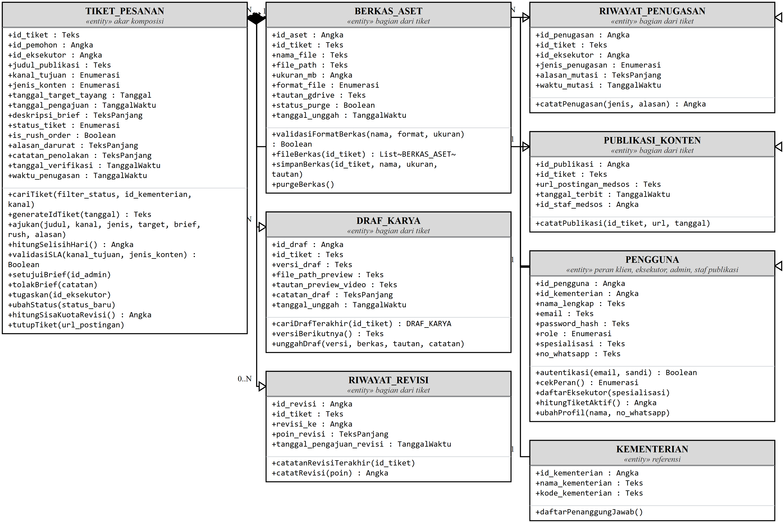

Keterangan: Relasi antar-kelas diwakili oleh garis komposisi (`*--`) dan asosiasi (`-->`), sementara atribut kunci tamu (FK) seperti `id_kementerian`, `id_pemohon`, `id_eksekutor`, `id_tiket`, dan `id_staf_medsos` tetap dicantumkan secara eksplisit pada kompartemen atribut kelas untuk memudahkan penelusuran langsung ke skema basis data logis pada Bab 4.2. Atribut turunan (`/kuota_revisi_terpakai`, `/selisih_hari`) ditulis sebagai operasi `hitungSisaKuotaRevisi()` dan `hitungSelisihHari()`.

Multiplicity setiap ujung asosiasi pada diagram di atas sama dengan kardinalitas pada Tabel 4.1b. Kelas `KEMENTERIAN`, `PENGGUNA`, `TIKET_PESANAN`, dan sisanya memakai nama serta atribut yang sama dengan entitas dan kamus data Bab 4.2 dan Bab 5.1.

**Kelas boundary dan control (dipakai karena kelompok memakai BCE).**

| Kelas | Stereotype | Tanggung Jawab Utama | Dipakai pada |
|---|---|---|---|
| FormPemesananUI | `«boundary»` | Merender formulir multi-kanal, menerima berkas aset, menampilkan pesan galat dan ID tiket. | SD-01 |
| DashboardAdminUI | `«boundary»` | Menampilkan antrean tiket, daftar eksekutor beserta beban kerja, dan dialog peringatan BR-04. | SD-02 |
| DashboardEksekutorUI | `«boundary»` | Menampilkan daftar tugas pribadi, tombol mulai pengerjaan, dan form unggah draf. | SD-03 |
| PanelReviewKlienUI | `«boundary»` | Menampilkan draf, sisa kuota revisi, tombol setujui final, dan form catatan revisi. | SD-04 |
| PengajuanController | `«control»` | Mengoordinasikan pengajuan tiket: validasi peran, validasi SLA, validasi berkas, penyimpanan tiket dan aset. | SD-01 |
| DisposisiController | `«control»` | Mengoordinasikan verifikasi brief, penugasan, penghitungan beban kerja, dan mutasi tugas. | SD-02 |
| ProduksiController | `«control»` | Mengoordinasikan pembaruan status pengerjaan dan penomoran versi draf. | SD-03 |
| ReviewPublikasiController | `«control»` | Mengoordinasikan peninjauan draf, kuota revisi, persetujuan final, pencatatan publikasi, dan auto-purge. | SD-04 |

## 6.2 Kontrak Operasi: Precondition dan Postcondition (tahap v1.1)

| Nama Kelas & Stereotype | Tanggung Jawab Utama | Metode Kunci & Kontrak (Pre → Post) | Keterlacakan (SRS dan IC) |
|---|---|---|---|
| TIKET_PESANAN `«entity»` (akar komposisi) | Mengelola siklus hidup tiket, memvalidasi perpindahan status, dan menghitung nilai turunan. | • `cariTiket(filter_status, id_kementerian, kanal)` : List~TIKET_PESANAN~ → Pre: pemanggil berperan Admin atau Klien pemilik tiket. Post: daftar tiket yang cocok dengan filter; Klien hanya menerima tiket `id_pemohon` miliknya (NFR-SEC-02, IC-02). • `generateIdTiket(tanggal)` → Pre: tanggal pengajuan valid. Post: nilai `#MED-YYYYMM-XXX` unik terbentuk (IC-01). • `ajukan(judul_publikasi, kanal_tujuan, jenis_konten, tanggal_target_tayang, deskripsi_brief, is_rush_order, alasan_darurat)` → Pre: kanal, jenis konten, dan tanggal target terisi; Klien terautentikasi. Post: tiket terbentuk dengan status `Submitted`, `is_rush_order` terisi sesuai IC-07. • `validasiSLA(kanal_tujuan, jenis_konten)` : Boolean → Pre: kanal_tujuan dan jenis_konten terdefinisi; tanggal target terisi. Post: true bila selisih hari memenuhi batas kanal dan jenis konten (BR-01); false memicu kewajiban alasan darurat (IC-07). • `setujuiBrief(id_pengguna_admin, tanggal_verifikasi)` → Pre: status = `Submitted`; pemanggil berperan Admin (BR-03). Post: `tanggal_verifikasi` terisi dan tiket dinyatakan layak untuk masuk ke tahap penugasan eksekutor (IC-09). • `tolakBrief(catatan)` → Pre: status = `Submitted`; catatan tidak kosong. Post: status ∈ {`Rejected`, `Revision Required`} dan `catatan_penolakan` terisi (IC-09). • `tugaskan(id_eksekutor, waktu_penugasan)` → Pre: status ∈ {`Submitted`, `Assigned`, `In Progress`}; eksekutor berperan Eksekutor; beban aktif eksekutor ≤ 3 atau Admin mengonfirmasi override (BR-04). Post: `id_eksekutor` dan `waktu_penugasan` diperbarui, status `Assigned` (IC-08, IC-09). • `ubahStatus(status_baru)` → Pre: transisi termasuk daftar IC-10. Post: `status_tiket` berubah dan aturan bersyarat atribut terkait terpenuhi (IC-04, IC-10). • `hitungSisaKuotaRevisi()` : Angka → Pre: tiket ada. Post: nilai 2 − jumlah baris RIWAYAT_REVISI, tidak disimpan (IC-06). • `hitungSelisihHari()` : Angka → Pre: kedua tanggal terisi. Post: nilai hari dihitung saat itu juga, tidak disimpan (IC-07). • `tutupTiket(url_postingan)` → Pre: status = `Ready to Post`; url tidak kosong. Post: status `Published` dan publikasi tercatat (IC-09, IC-10). | FR-02, FR-03, FR-05, FR-07, FR-08, FR-09, FR-11, FR-12, FR-13, FR-15, BR-01, BR-02, BR-03, BR-04, AC-03, AC-04, AC-08, AC-09, AC-11; IC-01, IC-04, IC-06, IC-07, IC-08, IC-09, IC-10 |
| PENGGUNA `«entity»` | Menyimpan identitas akun, memeriksa kredensial, dan menghitung beban tugas aktif eksekutor. | • `autentikasi(email, sandi)` : Boolean → Pre: email terdaftar. Post: true bila hash sandi cocok; pemanggilan gagal berulang dibatasi (AC-02); peran menentukan menu yang dirender (IC-04). • `cekPeran(id_pengguna)` : Enumerasi → Pre: id_pengguna terdaftar. Post: mengembalikan peran akun yang dipakai controller untuk memilih menu dan menolak akses di luar peran (IC-04). • `daftarEksekutor(spesialisasi)` : List~PENGGUNA~ → Pre: tidak ada. Post: daftar akun berperan Eksekutor beserta spesialisasinya untuk pemilihan penugasan (FR-08). • `hitungTiketAktif(id_eksekutor)` : Angka → Pre: role = Eksekutor. Post: jumlah tiket aktif dengan status_tiket ∈ {`Assigned`, `In Progress`, `Revision`} milik akun ini; dipakai memicu peringatan BR-04 (IC-08). • `ubahProfil(nama, no_whatsapp)` → Pre: pengguna terautentikasi. Post: `nama_lengkap` dan `no_whatsapp` diperbarui tanpa mengubah peran (FR-16). | FR-01, FR-08, FR-16, NFR-SEC-01, NFR-SEC-02, BR-04, AC-01, AC-02, AC-10; IC-04, IC-08 |
| KEMENTERIAN `«entity»` | Menyimpan data referensi kementerian dan menyediakan daftar penanggung jawab. | • `daftarPenanggungJawab()` : List~PENGGUNA~ → Pre: kementerian memiliki akun terdaftar. Post: daftar akun Klien milik kementerian tersebut; dipakai memisahkan kepemilikan data antar kementerian (NFR-SEC-02). | SRS §1.2, NFR-SEC-02; IC-02, IC-12 |
| BERKAS_ASET `«entity»` (bagian dari TIKET_PESANAN) | Menyimpan berkas aset tiket dan menegakkan kebijakan retensi. | • `validasiFormatBerkas(nama, format, ukuran)` : Boolean → Pre: berkas disertakan pengguna. Post: true bila format termasuk daftar IC-03 dan (ukuran ≤ 50 atau `tautan_gdrive` terisi) (IC-05). • `fileBerkas(id_tiket)` : List~BERKAS_ASET~ → Pre: tiket ada. Post: daftar berkas dengan `status_purge = false` untuk diunduh selama produksi (FR-04). • `simpanBerkas(id_tiket, nama, ukuran, tautan)` : Angka → Pre: tiket berstatus belum `Published`. Post: baris aset tersimpan dengan `status_purge = false` dan `id_aset` dikembalikan (IC-02). • `purgeBerkas()` → Pre: status tiket = `Published` (BR-05). Post: `status_purge = true` dan `file_path` dikosongkan, metadata tetap tersimpan (IC-11). | FR-04, FR-15, BR-05, AC-05, AC-18; IC-02, IC-03, IC-05, IC-11 |
| DRAF_KARYA `«entity»` (bagian dari TIKET_PESANAN) | Menyimpan draf karya per versi dan menentukan nomor versi berikutnya. | • `cariDrafTerakhir(id_tiket)` : DRAF_KARYA → Pre: tiket memiliki minimal satu draf. Post: baris draf dengan `versi_draf` tertinggi agar Klien meninjau versi terbaru (FR-11). • `versiBerikutnya(id_tiket)` : Teks → Pre: tiket memiliki minimal 0 draf. Post: `v1` bila belum ada draf, selain itu nomor tertinggi + 1; nilainya unik per tiket (IC-12). • `unggahDraf(id_tiket, versi_draf, file_path_preview, tautan_preview_video, catatan_draf)` → Pre: status tiket ∈ {`Assigned`, `In Progress`, `Revision`} dan salah satu dari berkas atau tautan pratinjau terisi. Post: baris draf tersimpan dan status tiket menjadi `Review` (IC-09, IC-10). | FR-10, FR-11, AC-12, AC-13; IC-09, IC-10, IC-12 |
| RIWAYAT_REVISI `«entity»` (bagian dari TIKET_PESANAN) | Menyimpan catatan revisi minor dan menegakkan kuota revisi. | • `catatanRevisiTerakhir(id_tiket)` : TeksPanjang → Pre: tiket ada. Post: poin revisi terakhir ditampilkan pada dasbor Eksekutor bersama tugasnya (FR-10, FR-12). • `catatRevisi(id_tiket, poin_revisi, revisi_ke)` : Angka → Pre: status tiket = `Review`; `hitungSisaKuotaRevisi()` > 0 (BR-02). Post: baris revisi tersimpan dengan `revisi_ke` dan status tiket menjadi `Revision`. Pre yang gagal: permintaan ditolak dengan pesan batas kuota (IC-06, IC-10). | FR-05, FR-12, BR-02, AC-06, AC-14, AC-15; IC-06, IC-10, IC-12 |
| PUBLIKASI_KONTEN `«entity»` (bagian dari TIKET_PESANAN) | Mencatat tautan tayang riil dan waktu terbit konten. | • `catatPublikasi(id_tiket, url_postingan_medsos, tanggal_terbit)` : Angka → Pre: status tiket = `Ready to Post`; url tidak kosong; satu tiket hanya boleh punya satu catatan publikasi. Post: baris publikasi tersimpan dengan `id_staf_medsos` pencatat (IC-09, IC-12). | FR-14, FR-15, AC-17, AC-18; IC-09, IC-12 |
| RIWAYAT_PENUGASAN `«entity»` (bagian dari TIKET_PESANAN) | Mencatat jejak penugasan awal dan mutasi penanggung jawab tiket. | • `catatPenugasan(id_tiket, id_eksekutor, jenis_penugasan, alasan_mutasi)` : Angka → Pre: tiket memiliki eksekutor yang ditetapkan; `alasan_mutasi` tidak kosong bila `jenis_penugasan = mutasi`. Post: baris riwayat tersimpan dengan `waktu_mutasi` terisi sehingga riwayat mutasi tiket dapat ditelusuri (AC-11). | FR-08, FR-09, AC-11; IC-09 |

Catatan: setiap operasi di atas muncul sebagai pesan pada Bab 3 dan sebaliknya, kecuali tiga operasi milik kebutuhan yang di luar cakupan sequence diagram Tugas 3: `PENGGUNA.autentikasi()` dan `PENGGUNA.ubahProfil()` (FR-01 dan FR-16, dikerjakan pada Pertemuan 12) serta `KEMENTERIAN.daftarPenanggungJawab()` (data referensi yang hanya dipakai sebagai pendukung tampilan), ditambah `TIKET_PESANAN.hitungSelisihHari()` yang merupakan operasi pembantu di dalam `validasiSLA()`. Ketiga operasi tetap dicantumkan pada kelas domain untuk kelengkapan model, tetapi tidak dipakai sebagai pesan pada SD-01 s.d. SD-04. Pesan yang diterima kelas boundary/control (`muatDaftarStaf()`, `simpanTiket()`, dan sejenisnya) tidak dimasukkan ke tabel ini karena bukan perilaku domain.

---

# 7. Cross-Model Consistency dan Keterlacakan

## 7.1 Requirements Traceability Matrix (RTM)

Seluruh kolom keterlacakan hulu (BPMN, Use Case, Activity Diagram) hingga hilir (Sequence Diagram, ERD/IC, dan Kelas Domain) telah terisi lengkap sesuai baseline v1.1. Kebutuhan di luar use case yang dimodelkan (FR-01, FR-16) ditandai "di luar cakupan SDD" sesuai batas pada Bab 2.2.

| ID Kebutuhan | Deskripsi Kebutuhan | Kriteria (AC) | BPMN & Use Case | Activity Diagram | Sequence Diagram (SDD) | Entitas, Kolom ERD & IC (SDD) | Kelas & Metode Domain (SDD) |
|---|---|---|---|---|---|---|---|
| FR-01 | Autentikasi kredensial dan pengarahan ke antarmuka sesuai peran | AC-01, AC-02 | BPMN-01 | di luar cakupan SDD (Pertemuan 12) | di luar cakupan SDD (pesan 3 pada SD-01 hanya memeriksa peran) | PENGGUNA (email, password_hash, role); IC-01, IC-04 | PENGGUNA.autentikasi(), PENGGUNA.hitungTiketAktif() |
| FR-02 | Klien membuat tiket baru via formulir multi-kanal | AC-03 | BPMN-01, UC-01 | AD-01 | SD-01 (Pesan 1 s.d. 24) | TIKET_PESANAN (id_tiket, judul_publikasi, kanal_tujuan, jenis_konten, tanggal_target_tayang, deskripsi_brief); IC-01, IC-03 | TIKET_PESANAN.ajukan(), TIKET_PESANAN.generateIdTiket() |
| FR-03 | Validasi SLA dan penandaan Rush Order dengan justifikasi | AC-04 | BPMN-01, UC-01 | AD-01 | SD-01 (Pesan 6 s.d. 10, guard `alt`) | TIKET_PESANAN (tanggal_target_tayang, tanggal_pengajuan, jenis_konten, is_rush_order, alasan_darurat); IC-07, IC-09 | TIKET_PESANAN.validasiSLA(), TIKET_PESANAN.hitungSelisihHari() |
| FR-04 | Unggah/unduh aset termasuk video > 50 MB dan auto-purge setelah Published | AC-05 | BPMN-01, UC-01, UC-04 | AD-01 | SD-01 (Pesan 11 s.d. 15), SD-04 (Pesan 22) | BERKAS_ASET (nama_file, file_path, ukuran_mb, format_file, tautan_gdrive, status_purge); IC-03, IC-05, IC-11 | BERKAS_ASET.validasiFormatBerkas(), BERKAS_ASET.simpanBerkas(), BERKAS_ASET.purgeBerkas() |
| FR-05 | Riwayat tiket Klien dan status real-time | AC-06 | BPMN-01, UC-04 | AD-04 | SD-04 (Pesan 1 s.d. 7) | TIKET_PESANAN (status_tiket, tanggal_pengajuan, kanal_tujuan); IC-04 | TIKET_PESANAN.ubahStatus(), RIWAYAT_REVISI.catatRevisi() |
| FR-06 | Daftar tiket masuk untuk Admin dengan filter | AC-07 | BPMN-01, UC-02 | AD-02 | SD-02 (Pesan 1 s.d. 5) | TIKET_PESANAN (status_tiket, id_pemohon, kanal_tujuan); KEMENTERIAN (nama_kementerian); IC-02 | TIKET_PESANAN.ubahStatus(), KEMENTERIAN.daftarPenanggungJawab() |
| FR-07 | Admin menyetujui atau menolak kelayakan brief | AC-08 | BPMN-01, UC-02 | AD-02 | SD-02 (Pesan 10 s.d. 13) | TIKET_PESANAN (status_tiket, catatan_penolakan, tanggal_verifikasi); IC-09, IC-10 | TIKET_PESANAN.setujuiBrief(), TIKET_PESANAN.tolakBrief() |
| FR-08 | Admin menugaskan eksekutor dengan indikator beban kerja | AC-09, AC-10 | BPMN-01, UC-02 | AD-02 | SD-02 (Pesan 14 s.d. 24) | TIKET_PESANAN (id_eksekutor, waktu_penugasan); PENGGUNA (role, spesialisasi); RIWAYAT_PENUGASAN (jenis_penugasan); IC-08, IC-09 | TIKET_PESANAN.tugaskan(), PENGGUNA.hitungTiketAktif(), RIWAYAT_PENUGASAN.catatPenugasan() |
| FR-09 | Re-assign tiket saat eksekutor overload atau berhalangan | AC-11 | BPMN-01, UC-02 | AD-02 | SD-02 (Pesan 25 s.d. 28, blok `opt`) | RIWAYAT_PENUGASAN (jenis_penugasan, alasan_mutasi, waktu_mutasi); TIKET_PESANAN (id_eksekutor); IC-08, IC-09 | RIWAYAT_PENUGASAN.catatPenugasan(), TIKET_PESANAN.tugaskan() |
| FR-10 | Daftar tugas pribadi Eksekutor beserta brief dan tenggat | AC-12 | BPMN-01, UC-03 | AD-03 | SD-03 (Pesan 1 s.d. 7) | TIKET_PESANAN (id_eksekutor, deskripsi_brief, tanggal_target_tayang); IC-02 | TIKET_PESANAN.ubahStatus() |
| FR-11 | Eksekutor memperbarui status dan mengunggah draf v1/v2 | AC-13 | BPMN-01, UC-03 | AD-03 | SD-03 (Pesan 12 s.d. 24) | DRAF_KARYA (versi_draf, file_path_preview, tautan_preview_video, catatan_draf, tanggal_unggah); TIKET_PESANAN (status_tiket); IC-09, IC-10, IC-12 | DRAF_KARYA.versiBerikutnya(), DRAF_KARYA.unggahDraf(), TIKET_PESANAN.ubahStatus() |
| FR-12 | Revisi minor Klien dibatasi maksimal 2 siklus | AC-14, AC-15 | BPMN-01, UC-04 | AD-04 | SD-04 (Pesan 8 s.d. 13) | RIWAYAT_REVISI (revisi_ke, poin_revisi, tanggal_pengajuan_revisi); TIKET_PESANAN (status_tiket); IC-06, IC-10, IC-12 | RIWAYAT_REVISI.catatRevisi(), TIKET_PESANAN.hitungSisaKuotaRevisi() |
| FR-13 | Klien memberi persetujuan final sehingga status Ready to Post | AC-16 | BPMN-01, UC-04 | AD-04 | SD-04 (Pesan 14 s.d. 17) | TIKET_PESANAN (status_tiket, tanggal_target_tayang); IC-10 | TIKET_PESANAN.ubahStatus() |
| FR-14 | Kalender editorial bulanan dan mingguan per kanal | AC-17 | BPMN-01, UC-04 | AD-04 | SD-04 (Pesan 18 s.d. 20) | TIKET_PESANAN (tanggal_target_tayang, kanal_tujuan); PUBLIKASI_KONTEN (tanggal_terbit); IC-03 | PUBLIKASI_KONTEN.catatPublikasi() |
| FR-15 | Status Published dengan tautan tayang dan auto-purge | AC-18 | BPMN-01, UC-04 | AD-04 | SD-04 (Pesan 18 s.d. 25) | PUBLIKASI_KONTEN (url_postingan_medsos, tanggal_terbit, id_staf_medsos); BERKAS_ASET (status_purge, file_path); IC-09, IC-11, IC-12 | PUBLIKASI_KONTEN.catatPublikasi(), TIKET_PESANAN.tutupTiket(), BERKAS_ASET.purgeBerkas() |
| FR-16 | Pembaruan profil dan penggantian kata sandi mandiri | – (belum ada AC pada SRS) | di luar cakupan SDD | di luar cakupan SDD | di luar cakupan SDD | PENGGUNA (nama_lengkap, no_whatsapp, password_hash) | PENGGUNA.ubahProfil() |
| NFR-SEC-01 | Kata sandi disimpan sebagai hash searah | AC-01 | – | – | SD-01 (Pesan 3 memakai identitas akun) | PENGGUNA.password_hash (tanpa atribut sandi asli) | PENGGUNA.autentikasi() |
| NFR-SEC-02 | RBAC: Klien tidak dapat mengakses data kementerian lain; penugasan hanya Admin | AC-09, AC-11 | – | – | SD-02 (Pesan 22, 23, 27) | PENGGUNA (role, id_kementerian); KEMENTERIAN (id_kementerian); IC-02, IC-04 | PENGGUNA.autentikasi(), KEMENTERIAN.daftarPenanggungJawab() |
| NFR-SEC-03 | Sanitasi masukan formulir terhadap SQL Injection dan XSS | tidak ada AC khusus | di luar cakupan SDD | di luar cakupan SDD | di luar cakupan SDD | tidak dimodelkan: sanitasi adalah kontrol lapisan akses data, bukan struktur tabel (dirancang pada Pertemuan 12) | tidak dimodelkan: penegakan di lapisan akses data/ORM |
| NFR-PERF-01 | Waktu respons pemuatan halaman dan status tiket ≤ 2 detik | AC-06, AC-07 | – | – | SD-02 (Pesan 2 s.d. 5), SD-03 (Pesan 2 s.d. 7), SD-04 (Pesan 2 s.d. 7) | TIKET_PESANAN (status_tiket, id_eksekutor) — pencarian tiket difilter langsung pada kolom status | TIKET_PESANAN.ubahStatus() |
| NFR-USE-01 | Formulir pengajuan selesai diisi ≤ 5 menit oleh Klien baru | AC-03 | – | – | SD-01 (Pesan 5, 11, 16) | TIKET_PESANAN (kanal_tujuan, judul_publikasi, deskripsi_brief) | TIKET_PESANAN.ajukan() |
| NFR-PORT-01 | Antarmuka responsif 360px sampai 1920px | – | – | – | tidak berdampak pada model data | – | kelas `«boundary»` pada Bab 6.1 |
| BR-01 | Batas minimum pengajuan H-4/H-5/H-7 menurut kanal dan jenis konten; di bawah itu wajib dispensasi | AC-04 | BPMN-01 (gateway) | AD-01 | SD-01 (Pesan 6 s.d. 10, blok `opt`) | TIKET_PESANAN (kanal_tujuan, jenis_konten, tanggal_target_tayang, tanggal_pengajuan, is_rush_order, alasan_darurat); IC-07 | TIKET_PESANAN.validasiSLA(), TIKET_PESANAN.ajukan() |
| BR-02 | Maksimal 2 siklus revisi minor; perubahan konsep total wajib tiket baru | AC-14, AC-15 | BPMN-01 (gateway) | AD-04 | SD-04 (Pesan 8 s.d. 13, blok `alt` bersarang) | RIWAYAT_REVISI (revisi_ke); TIKET_PESANAN (/kuota_revisi_terpakai turunan); IC-06 | RIWAYAT_REVISI.catatRevisi(), TIKET_PESANAN.hitungSisaKuotaRevisi() |
| BR-03 | Penugasan dan mutasi hanya boleh oleh Admin | AC-09, AC-11 | BPMN-01 (swimlane Admin) | AD-02 | SD-02 (Pesan 21 s.d. 28) | PENGGUNA (role); TIKET_PESANAN (id_eksekutor, waktu_penugasan); IC-04, IC-09 | TIKET_PESANAN.tugaskan(), RIWAYAT_PENUGASAN.catatPenugasan() |
| BR-04 | Maksimal 3 tiket aktif In Progress per eksekutor | AC-10 | BPMN-01 (gateway) | AD-02 | SD-02 (Pesan 18 s.d. 20, blok `opt`) | TIKET_PESANAN (status_tiket, id_eksekutor); PENGGUNA (role); IC-08 | PENGGUNA.hitungTiketAktif(), TIKET_PESANAN.tugaskan() |
| BR-05 | Retensi aset: berkas fisik dihapus otomatis setelah Published, metadata tetap | AC-05, AC-18 | BPMN-01 (data store) | AD-04 | SD-04 (Pesan 22 s.d. 23) | BERKAS_ASET (status_purge, file_path, ukuran_mb, tautan_gdrive); IC-05, IC-11 | BERKAS_ASET.purgeBerkas(), BERKAS_ASET.validasiFormatBerkas() |

## 7.2 CRUD Matrix: Use Case × Entitas

| Use Case | KEMENTERIAN | PENGGUNA | TIKET_PESANAN | BERKAS_ASET | DRAF_KARYA | RIWAYAT_REVISI | PUBLIKASI_KONTEN | RIWAYAT_PENUGASAN |
|---|---|---|---|---|---|---|---|---|
| UC-01 Pengajuan Tiket Request Konten | R | R | C | C | – | – | – | – |
| UC-02 Validasi dan Penugasan Tiket Konten | R | R | RU | R | – | – | – | C |
| UC-03 Pengerjaan dan Unggah Draf Karya | R | R | RU | R | C | R | – | R |
| UC-04 Tinjauan Draf, Persetujuan Akhir, dan Publikasi | R | R | RU | RU | R | CR | C | – |
| Ada C? | sumber data | sumber data | ✓ | ✓ | ✓ | ✓ | ✓ | ✓ |
| Ada D? | – | – | – | – | – | – | – | – |

Aturan baca yang dipatuhi: tidak ada operasi D pada satu pun entitas. Penghapusan data tidak dilakukan karena SRS menuntut pelacakan riwayat (FR-05, FR-12, FR-15) dan retensi metadata aset (BR-05); pembatalan diwakili perubahan `status_tiket` dan penanda `status_purge`. Dua entitas tanpa C adalah `KEMENTERIAN` dan `PENGGUNA`: keduanya data master yang sumbernya adalah pendataan akun 14 kementerian dan staf Medkreminfo (SRS §2.1 dan FR-01), dan pengelolaan akun penuh dirancang pada Pertemuan 12 sesuai batas Bab 1.3.

## 7.3 Data Scenario Walkthrough

Skenario yang ditelusuri: UC-01 (pengajuan tiket) dilanjutkan UC-02 (validasi dan penugasan) pada ERD logis Bab 4.2.

| Langkah | Operasi Data | Entitas.atribut | Ada? | Temuan / Tindak Lanjut |
|---|---|---|---|---|
| 1 | Periksa peran dan kementerian pemohon (R) | PENGGUNA.role, PENGGUNA.id_kementerian | Ya | – |
| 2 | Hitung selisih hari terhadap batas SLA kanal (R) | TIKET_PESANAN.tanggal_pengajuan, TIKET_PESANAN.tanggal_target_tayang, TIKET_PESANAN.kanal_tujuan | Ya | Atribut `/selisih_hari` dan `/kuota_revisi_terpakai` tidak disimpan, dihitung saat dibutuhkan (IC-07). |
| 3 | Simpan tiket baru beserta penanda darurat (C) | TIKET_PESANAN.status_tiket, TIKET_PESANAN.is_rush_order, TIKET_PESANAN.alasan_darurat | Ya | – |
| 4 | Simpan berkas aset dan validasi batas 50 MB (C) | BERKAS_ASET.file_path, BERKAS_ASET.ukuran_mb, BERKAS_ASET.tautan_gdrive | Ya | – |
| 5 | Admin membaca antrean dan beban kerja tiap eksekutor (R) | TIKET_PESANAN.id_eksekutor, TIKET_PESANAN.status_tiket | Ya | Beban kerja tiket aktif ({Assigned, In Progress, Revision}) dihitung dengan `hitungTiketAktif()`, tidak perlu kolom penghitung (IC-08). |
| 6 | Catat penugasan awal atau mutasi eksekutor (C) | RIWAYAT_PENUGASAN.jenis_penugasan, RIWAYAT_PENUGASAN.alasan_mutasi, RIWAYAT_PENUGASAN.waktu_mutasi | Ya | Pada SDD v1.0 langkah ini gagal karena belum ada entitas riwayat penugasan sementara AC-11 menuntut riwayat mutasi tercatat → DEF-01; entitas `RIWAYAT_PENUGASAN` ditambahkan pada v1.1. |
| 7 | Auto-purge berkas setelah tiket Published (U) | BERKAS_ASET.status_purge, BERKAS_ASET.file_path | Ya | `file_path` dikosongkan tetapi `ukuran_mb`, `format_file`, dan `tautan_gdrive` dipertahankan sesuai BR-05 (IC-11). |
| 8 | Tutup tiket dengan mencatat tautan tayang (C + U) | PUBLIKASI_KONTEN.url_postingan_medsos, PUBLIKASI_KONTEN.tanggal_terbit, TIKET_PESANAN.status_tiket | Ya | – |

## 7.4 Checklist Konsistensi Lintas Model

| No | Pemeriksaan | Artefak yang Dibandingkan | Hasil (Lolos / Defect) | ID Defect |
|---|---|---|---|---|
| 1 | Setiap FR, NFR, dan BR pada RTM terhubung ke use case, sequence, entitas/kolom, dan kelas/metode; setiap use case, tabel, dan kelas merujuk balik ke kebutuhan SRS. | RTM ↔ SRS ↔ Bab 3–6 | Lolos | – |
| 2 | Setiap use case pada katalog memiliki sequence diagram dan tabel skenario, selaras dengan narasi use case. | Katalog 2.2 ↔ Bab 3 ↔ SRS §6.2 | Lolos | – |
| 3 | Setiap lifeline objek domain pada sequence ada sebagai kelas pada 6.1 dengan nama yang sama. | Bab 3 ↔ 6.1 | Lolos | – |
| 4 | Setiap pesan ke objek domain ada sebagai operasi pada kelas tujuan (nama dan parameter sama), dan sebaliknya. | Bab 3 ↔ 6.2 | Defect (diperbaiki) | DEF-02 |
| 5 | Setiap entitas ERD logis memiliki kelas domain; nama sesuai glosarium dan atribut sama kecuali FK. | ERD ↔ 6.1 ↔ 1.4 | Lolos | – |
| 6 | Setiap atribut ERD terdefinisi pada kamus data dan sebaliknya; setiap parameter data pada pesan sequence memiliki atribut atau kolom pada ERD. | ERD ↔ 5.1 ↔ Bab 3 | Lolos | – |
| 7 | Kardinalitas setiap relasi ERD sama dengan multiplicity pada domain model. | 4.1b, 4.2 ↔ 6.1 | Lolos | – |
| 8 | Setiap BR pada SRS memiliki IC atau catatan alasan mengapa tidak dijadikan IC. | SRS §5 ↔ 5.2 | Defect (diperbaiki) | DEF-03 |
| 9 | Setiap IC memiliki sumber BR/FR dan tempat penegakan; IC bersyarat selaras dengan kolom Wajib pada kamus data. | 5.2 ↔ 5.1 | Lolos | – |
| 10 | Setiap entitas memiliki minimal satu C dan satu R pada CRUD matrix; setiap D dibenarkan. | 7.2 ↔ ERD | Lolos (KEMENTERIAN dan PENGGUNA memakai jalur pengecualian sumber data master) | – |
| 11 | CRUD matrix selaras dengan sequence: use case yang membuat atau mengubah data memang memanggil operasi terkait. | 7.2 ↔ Bab 3 | Lolos | – |
| 12 | Atribut turunan tidak disimpan dan memiliki operasi penghitung pada kelas domain. | 5.1 ↔ 6.2 | Lolos | – |
| 13 | Setiap perubahan v1.0 → v1.1 tercermin pada seluruh artefak terdampak dan tercatat pada revision log. | Lampiran A ↔ semua artefak | Lolos | – |

## 7.5 Defect Log dan Peer Review

| ID | Temuan | Artefak (Sumber → Tujuan) | Jenis | Ditemukan oleh | Tindakan Perbaikan | Status |
|---|---|---|---|---|---|---|
| DEF-01 | AC-11 menuntut riwayat mutasi penugasan tercatat pada changelog tiket, tetapi ERD v1.0 hanya menyimpan `id_eksekutor` terakhir sehingga jejak penugasan hilang saat re-assign. | SRS FR-09/AC-11 → ERD logis, kamus data, domain model | Kurang | Mandiri + walkthrough langkah 6 | Menambah entitas `RIWAYAT_PENUGASAN` beserta kamus data, relasi, IC-09, kelas domain, dan operasi `catatPenugasan()`; memperbarui RTM, CRUD matrix, dan SD-02. | Selesai |
| DEF-02 | Pesan `validasiFormatBerkas()` dan `versiBerikutnya()` pada SD-01 dan SD-03 belum ada sebagai operasi pada kelas `BERKAS_ASET` dan `DRAF_KARYA` di v1.0. | SD-01, SD-03 → 6.1, 6.2 | Inkonsistensi | Mandiri (checklist butir 4) | Menambah kedua operasi pada kelas domain beserta kontrak operasinya pada Bab 6.2. | Selesai |
| DEF-03 | BR-02 pada v1.0 hanya tertulis sebagai batas kuota tanpa ekspresi yang dapat diuji, sehingga belum ada IC yang menegakkannya secara eksplisit. | SRS BR-02 → 5.2 | Kurang | Mandiri (checklist butir 8) | Menambah IC-06 (kuota ≤ 2 dan `revisi_ke` ∈ {1,2}) serta IC-12 (unik gabungan `id_tiket` + `revisi_ke`). | Selesai |
| DEF-04 | SRS §10.3 mencantumkan 7 nilai status tiket, sedangkan UC-02 membutuhkan status keputusan `Rejected` dan `Revision Required`. | SRS §10.3 → IC-04 | Inkonsistensi | Mandiri | SDD menetapkan 9 nilai status pada IC-04 dan kamus data, lalu mengusulkan SRS v1.1 menyelaraskan daftar status agar kedua dokumen sama; batas waktu dan bukti AC-08 tetap terpenuhi. | Selesai (SDD); diusulkan untuk SRS |
| DEF-05 | BR-01 mengatur batas H-5 untuk Carousel/LinkedIn, sedangkan FR-02 hanya menyebut 4 kanal resmi tanpa pemisahan jenis konten Carousel. | SRS FR-02 ↔ BR-01 → IC-03 | Inkonsistensi | Mandiri | Kanal diselaraskan menjadi 4 kanal resmi ({Instagram Feeds, Instagram Story, LinkedIn, TikTok}) dan ditambah atribut `jenis_konten` {Poster, Carousel, Video, Siaran Pers} pada ERD, kamus data, IC-03, IC-07, dan kelas domain. | Selesai |
| DEF-09 | Ketidaksesuaian daftar parameter operasi antara Sequence Diagram (Bab 3) dan Kontrak Operasi (Bab 6.2), kontradiksi keterangan atribut FK pada Bab 6.1, celah status aktif pada IC-08, serta sisa teks draf v1.0 pada Bab 7.1 dan Lampiran B. | Bab 3 ↔ 6.2, Bab 6.1, 5.2 ↔ 6.2, Bab 7.1, Lampiran B | Inkonsistensi & Kelengkapan | Mandiri (Audit Lanjutan v1.1) | Menyamakan seluruh parameter operasi di Bab 6.2 dengan pesan di Bab 3, merevisi keterangan Gambar 6.1, memperluas status beban aktif IC-08 menjadi {Assigned, In Progress, Revision}, dan membersihkan sisa teks v1.0. | Selesai |
| DEF-06 | [ISI SAAT PEER REVIEW: nomor checklist 7.4 yang diuji] | [Sumber → Tujuan] | [Jenis] | Peer review: [nama kelompok] | [Tindakan] | [Terbuka / Ditolak + alasan] |
| DEF-07 | [ISI SAAT PEER REVIEW: nomor checklist 7.4 yang diuji] | [Sumber → Tujuan] | [Jenis] | Peer review: [nama kelompok] | [Tindakan] | [Terbuka / Ditolak + alasan] |
| DEF-08 | [ISI SAAT PEER REVIEW: nomor checklist 7.4 yang diuji] | [Sumber → Tujuan] | [Jenis] | Peer review: [nama kelompok] | [Tindakan] | [Terbuka / Ditolak + alasan] |

---

# Lampiran A. Revision Log (v1.0 → v1.1)

| No | Perubahan | Pemicu | Artefak Terdampak | Versi |
|---|---|---|---|---|
| 1 | Menambah entitas `RIWAYAT_PENUGASAN` (id_penugasan, id_tiket, id_eksekutor, jenis_penugasan, alasan_mutasi, waktu_mutasi) beserta 2 relasinya. | DEF-01; walkthrough langkah 6 | ERD konseptual dan logis, 4.1a, 4.1b, kamus data 5.1.8, IC-09, kelas domain 6.1, kontrak 6.2, RTM 7.1, CRUD matrix 7.2 | v1.1 |
| 2 | Menambah operasi `validasiFormatBerkas()` dan `simpanBerkas()` pada kelas `BERKAS_ASET` serta `versiBerikutnya()` dan `unggahDraf()` pada kelas `DRAF_KARYA`. | DEF-02; checklist butir 4 | Domain model 6.1, kontrak operasi 6.2, SD-01 dan SD-03, RTM 7.1 | v1.1 |
| 3 | Menambah IC-06 (kuota revisi ≤ 2 dan `revisi_ke` ∈ {1,2}) dan IC-12 (kunci unik gabungan serta `PUBLIKASI_KONTEN.id_tiket` unik). | DEF-03; checklist butir 8 | Bagian 5.2, kamus data 5.1.5 dan 5.1.6, Bab 4.2 catatan UK, domain model 6.2 | v1.1 |
| 4 | Menetapkan 9 nilai enumerasi `status_tiket` dan menyeragamkannya pada kamus data, IC-04, dan IC-10. | DEF-04; usulan penyelarasan SRS §10.3 | Kamus data 5.1.3, IC-04, IC-10, kelas `TIKET_PESANAN` 6.1 | v1.1 |
| 5 | Menetapkan `Instagram Carousel` sebagai nilai kelima `kanal_tujuan` agar batas H-5 pada BR-01 dapat ditegakkan. | DEF-05; usulan penyelarasan SRS FR-02 | Kamus data 5.1.3, IC-03, IC-07, RTM 7.1 | v1.1 |
| 6 | Menambah atribut `tanggal_verifikasi` pada `TIKET_PESANAN` agar keputusan Admin pada AC-08 punya jejak waktu, dan `tanggal_unggah` pada `BERKAS_ASET` dan `DRAF_KARYA`. | Audit checklist butir 6 (pesan 13 SD-02 sebelumnya tidak punya kolom tujuan) | ERD logis 4.2, kamus data 5.1.3, 5.1.4, 5.1.5, IC-09, kelas domain 6.1 | v1.1 |
| 7 | Menandai `/kuota_revisi_terpakai` dan `/selisih_hari` sebagai atribut turunan tidak disimpan beserta operasi penghitungnya. | Audit checklist butir 12 | Kamus data 5.1.3, kelas domain 6.1, kontrak operasi 6.2, Bab 4.2 uji 3NF | v1.1 |
| 8 | Menambahkan kolom ketersediaan artefak hulu (BPMN-01, UCD-01, AD-01..AD-04) pada tabel 1.2 beserta catatan tautan yang belum tersedia. | Audit keterlacakan hulu | Bab 1.2, RTM 7.1 | v1.1 |
| 9 | Menambah operasi baca pada kelas domain agar setiap pesan pada sequence diagram punya operasi tujuan: `PENGGUNA.cekPeran()`, `PENGGUNA.daftarEksekutor()`, `TIKET_PESANAN.cariTiket()`, `BERKAS_ASET.fileBerkas()`, `DRAF_KARYA.cariDrafTerakhir()`, `RIWAYAT_REVISI.catatanRevisiTerakhir()`; nama pesan `findTiket`, `findDrafTerakhir`, dan `purgeAset` diseragamkan menjadi `cariTiket`, `cariDrafTerakhir`, dan `purgeBerkas`. | DEF-02 lanjutan; checklist butir 4 | SD-01 s.d. SD-04, domain model 6.1, kontrak operasi 6.2, RTM 7.1 | v1.1 |
| 10 | Menambahkan baris NFR-SEC-03 pada RTM dengan penanda "di luar cakupan SDD" karena SRS memuatnya tetapi tidak ada struktur data atau operasi domain yang dapat memodelkannya. | Checklist butir 1 (tidak ada kebutuhan SRS tanpa baris RTM) | Bab 7.1 | v1.1 |
| 11 | Menyetel ulang enumerasi kanal menjadi 4 kanal resmi (Instagram Feeds, Story, LinkedIn, TikTok) dan menambah atribut `jenis_konten` {Poster, Carousel, Video, Siaran Pers} sebagai penentu batas SLA bersama kanal. | Bukti PC-01 §1.0 dan W06; menutup DEF-05 | ERD logis 4.2, kamus data 5.1.3, IC-03, IC-07, kelas `TIKET_PESANAN` 6.1, SD-01 pesan 5–7 dan 20, RTM 7.1 | v1.1 |
| 12 | Menambah daftar skenario (Bab 3.1), Lampiran B (pembagian kontribusi), dan Lampiran C (sumber diagram dan repository) mengikuti isi minimal RTM Tugas 3. | Ketentuan isi minimal RTM Tugas 3 | Bab 3.1, Lampiran B, Lampiran C | v1.1 |
| 13 | Menambah artefak hulu yang tersedia ke tabel 1.2: PC-01 Project Charter, EL-01 Dokumen Hasil Wawancara, dan ERD-P10; catatan ketersediaan BPMN/UCD/AD dipertegas. | Checklist butir 1; audit keterlacakan hulu | Bab 1.2, RTM 7.1 | v1.1 |
| 14 | Menyediakan artefak hulu yang sebelumnya berstatus belum tersedia: BPMN-01 (proses to-be lintas swimlane), UCD-01 (use case diagram), dan AD-01..AD-04 (activity diagram per use case). | Bab 1.2, Bab 7.1, Lampiran D | BPMN-01, UCD-01, AD-01..AD-04 (berkas sumber: `diagrams_upstream/`, format Draw.io XML, SVG, PNG) | v1.1 |
| 15 | Memperbarui catatan ketersediaan artefak dan kolom BPMN & Use Case serta Activity Diagram pada RTM sehingga seluruh rantai keterlacakan terisi. | Bab 1.2, Bab 7.1 | RTM v1.1 (semua baris FR/NFR/BR) | v1.1 |
| 16 | Penyelarasan parameter operasi Bab 6.2 dengan Sequence Diagram Bab 3, koreksi keterangan atribut FK pada Gambar 6.1, perluasan status beban aktif IC-08 ({Assigned, In Progress, Revision}), pembersihan sisa teks v1.0 pada Bab 7.1 dan Lampiran B, serta koreksi 5 swimlane BPMN-01. | DEF-09; Audit kelengkapan akhir v1.1 | Bab 5.2, Bab 6.1, Bab 6.2, Bab 7.1, Bab 7.3, Bab 7.5, Lampiran B, Lampiran D.1 | v1.1 |

---

# Lampiran B. Pembagian Kontribusi Anggota Tim

Pembagian berikut mengikuti peran pada SRS Lampiran B dan dipetakan ke artefak SDD yang dikerjakan pada tahap v1.0 dan v1.1.

| NIM | Nama | Peran | Kontribusi pada SDD v1.0 & v1.1 |
|---|---|---|---|
| H1D025052 | Timotius Willy Narendra | Project Manager | Menetapkan batas ruang lingkup SDD (Bab 1.3), menyelaraskan Bab 1–2 dengan Project Charter dan SRS, memimpin konsolidasi dokumen serta peninjauan akhir. |
| H1D025067 | Fardizza Vinda Rahman | Analis Sistem | Menyusun katalog use case (Bab 2.2), tabel spesifikasi skenario interaksi (Tabel 3.2–3.5), dan kamus data per entitas (Bab 5.1). |
| H1D025059 | Adridinan Najmi Faza | Pengembang Perangkat Lunak | Menyusun sequence diagram SD-01 s.d. SD-04 beserta berkas sumber diagramnya, ERD konseptual dan logis 3NF (Bab 4.2), serta Integrity Constraint Bab 5.2 yang diturunkan dari ERD kandidat Pertemuan 10. |
| H1D022109 | Salman Thufail | Pengembang Perangkat Lunak | Menyusun model kelas domain dan kontrak operasi (Bab 6.1–6.2), memeriksa keselarasan multiplicity terhadap kardinalitas ERD, serta menyiapkan bahan audit lintas model. |

---

# Lampiran C. Sumber Diagram dan Repository

| Diagram | Berkas sumber (vektor) | Generator |
|---|---|---|
| SD-01 s.d. SD-04 (Bab 3) | `images/seq_diagram_sd01.png` s.d. `seq_diagram_sd04.png` | `build/gen_sequences.py` — membaca blok Mermaid pada Bab 3 lalu menggambar ulang pada kanvas 950–1120 px agar teks pesan terbaca saat dicetak. |
| ERD konseptual dan ERD logis 3NF (Bab 4) | `images/diagram_erd_konseptual.png`, `images/diagram_erd_logis.png` | `build/gen_diagrams.py` — entitas, atribut, kunci, dan relasi ditulis sebagai struktur Python agar konsisten dengan kamus data Bab 5.1. |
| UML Class Diagram gabungan 8 kelas (Bab 6.1) | `images/diagram_class_full.svg` (PNG: `diagram_class_full.png`; tab Bab 6.1 pada `SDD_Medkreminfo_Diagram.drawio`) | `build/gen_class_full.py` + `build/gen_diagrams.py` — tiga kolom, anggota kelas dibungkus agar kotak ramping; kanvas 1274 x 874 px dipasang pada halaman lanskap sehingga teks anggota menjadi 7 pt. |

Repository artefak kelompok: https://github.com/najmifaza/Tugas-ADS-smst-3 (folder `Tugas Per 11`). Berkas keluaran tugas: `Tugas_3_KelompokXX_AnalysisModels.docx` dan `.pdf` (nama berkas mengikuti ketentuan RTM Tugas 3). Berkas sumber diagram disertakan pada folder `build/` dan `images/` sesuai ketentuan "sertakan berkas sumber diagram atau tautan repository pada lampiran".

---

# Lampiran D. Artefak Hulu: BPMN To-Be, Use Case Diagram, dan Activity Diagram

Artefak pada lampiran ini adalah baseline hulu yang dirujuk Bab 1.2 dan kolom keterlacakan Bab 7.1. Semuanya diturunkan dari SRS v1.0 (§2.1, §5, §6.2), Project Charter (PC-01), dan dipakai konsisten oleh sequence diagram Bab 3.

## D.1 BPMN-01: Proses To-Be Layanan Pemesanan Konten

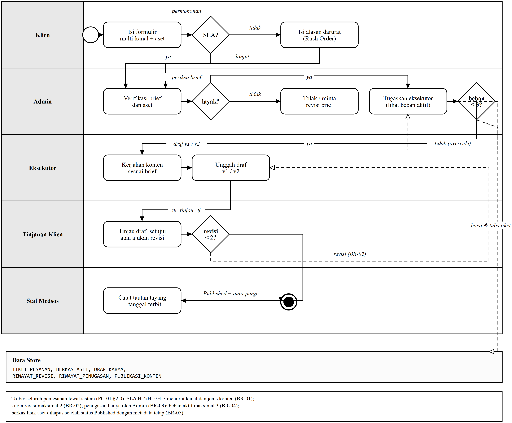

Lima swimlane proses/aktor (Klien, Admin, Eksekutor, Tinjauan Klien, dan Staf Medsos) ditambah satu data store. Gateway yang dimodelkan: kepatuhan SLA (BR-01), kelayakan brief (FR-07), batas beban aktif ≤ 3 tiket (BR-04), dan kuota revisi (BR-02). Alur berakhir pada status `Published` dengan auto-purge berkas fisik (BR-05).

## D.2 UCD-01: Use Case Diagram

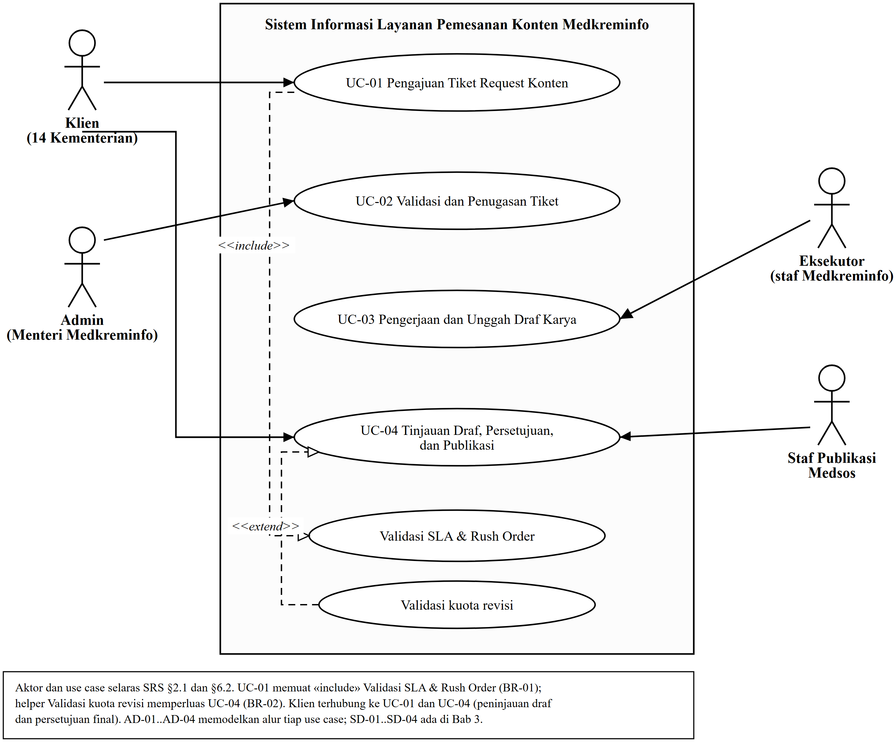

Use case bernomor selaras SRS §6.2. Relasi `<<include>>` pada UC-01 → validasi SLA dan `<<extend>>` pada UC-04 → validasi kuota revisi.

## D.3 AD-01: Activity Diagram UC-01 Pengajuan Tiket Request Konten

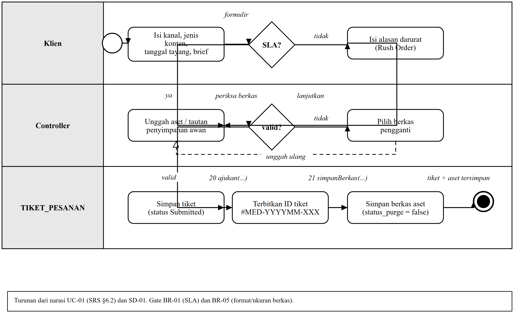

## D.4 AD-02: Activity Diagram UC-02 Validasi dan Penugasan Tiket

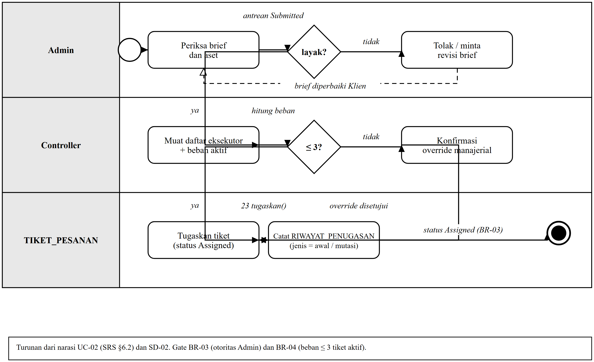

## D.5 AD-03: Activity Diagram UC-03 Pengerjaan dan Unggah Draf Karya

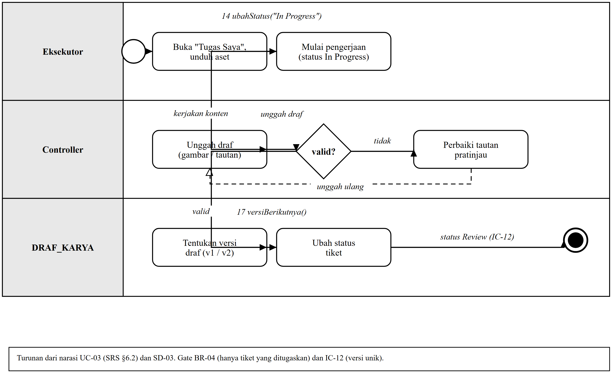

## D.6 AD-04: Activity Diagram UC-04 Tinjauan Draf, Persetujuan Akhir, dan Publikasi

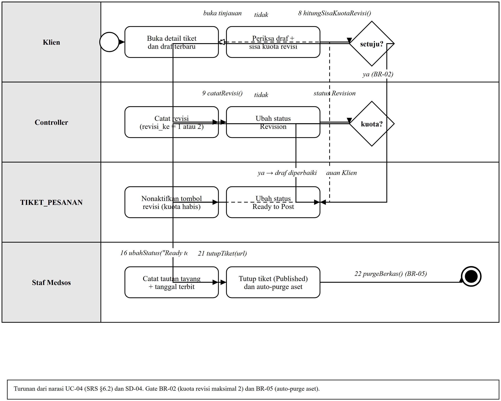

Berkas sumber tiap diagram tersedia dalam tiga bentuk: PNG (gambar yang dipasang), SVG (vektor), dan satu berkas Draw.io XML `SDD_Medkreminfo_Diagram.drawio` yang memuat seluruh 13 diagram sebagai tab terpisah (folder `diagrams_upstream/` untuk artefak hulu, `images/` untuk diagram SDD).
