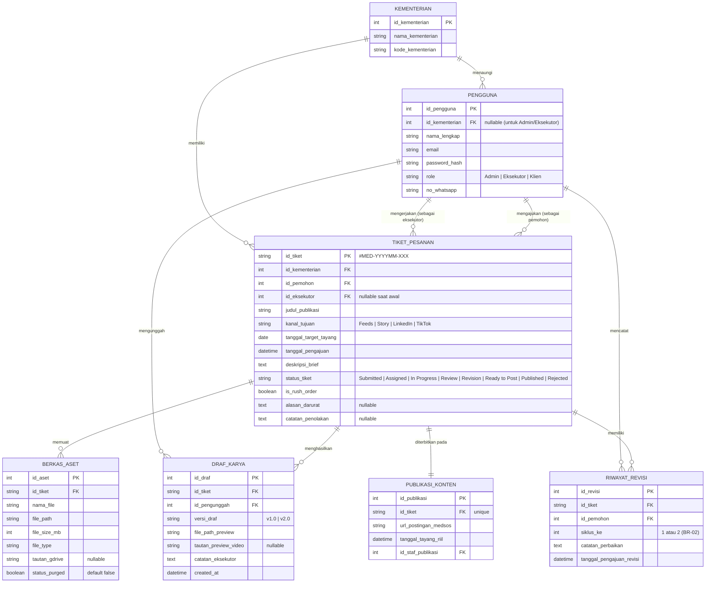

# Laporan Tugas Mandiri Pertemuan 10 – Pemodelan Data (ERD v1)
## IF21307 Analisis dan Desain Sistem

---

### Identitas Mahasiswa & Tugas
* **Nama Lengkap:** Adridinan Najmi Faza
* **NIM:** H1D025059
* **Nama Tim Proyek:** Tim Medkreminfo (Kelompok Proyek ADS)
* **Judul Proyek SRS:** Sistem Informasi Layanan Pemesanan Konten Medkreminfo BEM FT UNSOED (Baseline v1.0)
* **Use Case Terpilih:** UC-01 – Pengajuan Tiket Request Konten (Klien)

---

## Bagian A. Use Case Narrative yang Ditandai

Salinan apa adanya dari dokumen SRS Tim (Bab 6.2 UC-01), dengan penandaan:
* Kata benda (kandidat entitas / atribut) **ditebalkan (bold)**.
* Kata kerja (kandidat relasi) *dimiringkan (italic)*.

### UC-01: Pengajuan Tiket Request Konten (Klien)
* **Aktor Utama:** **Klien** (**Perwakilan Kementerian BEM FT**)
* **Precondition:** **Pengguna** telah *terautentikasi* ke dalam **sistem** dengan **akun** **peran Klien**.
* **Trigger:** **Klien** *memilih* **menu "Buat Pesanan Konten Baru"**.
* **Main Flow (Alur Utama):**
  1. **Klien** *membuka* **halaman formulir pemesanan konten**.
  2. **Klien** *mengisi* **judul publikasi**, *memilih* **kanal tujuan** (**Instagram Feeds** / **Story** / **LinkedIn** / **TikTok**), dan *memilih* **tanggal target tayang**.
  3. **Sistem** *memverifikasi* **selisih hari** **tanggal target tayang** terhadap **aturan SLA** (**BR-01**).
  4. **Klien** *mengunggah* **berkas materi pendukung** (**gambar** / **dokumen** / **video**) atau *menyematkan* **tautan Google Drive**, serta *memasukkan* **deskripsi brief naskah**.
  5. **Klien** *menekan* **tombol "Kirim Permohonan"**.
  6. **Sistem** *memvalidasi* **kelengkapan isian formulir** dan *menerima* **berkas aset pendukung** (termasuk **berkas video > 50 MB** sesuai **BR-05**).
  7. **Sistem** *menerbitkan* **ID tiket unik** (format `#MED-YYYYMM-XXX`), *menyimpan* **data** dengan **status `Submitted`**, dan *mengirimkan* **notifikasi konfirmasi**.

* **Alternate Flow (Alur Alternatif):**
  * *3a. Pengajuan Mendadak (< Batas Hari SLA):*
    1. **Sistem** *menampilkan* **peringatan** bahwa **target tanggal tayang** *melanggar* **batas waktu standar pengerjaan** (**BR-01**).
    2. **Sistem** *membuka* **kolom isian wajib**: "**Alasan Kebutuhan Darurat (Dispensasi Urgent)**".
    3. **Klien** *mengisi* **justifikasi darurat**, **tiket** *diberi* **label `Rush Order`**, dan **alur** *berlanjut* ke langkah 4.

* **Exception (Pengecualian):**
  * *6a. Format Ekstensi Berkas Tidak Didukung:*
    1. **Sistem** *menolak* **berkas** dan *menampilkan* **pesan galat**: "Format berkas tidak didukung. Unggah berkas valid atau cantumkan tautan Google Drive".
    2. **Pengguna** *diminta* *memilih* **berkas pengganti** atau *menyematkan* **tautan penyimpanan awan**.
    3. **Alur** *kembali* ke langkah 4.

* **Postcondition:** **Tiket** *tercatat* pada **basis data** berstatus `Submitted` dan *muncul* di **antrean verifikasi Admin**.

---

## Bagian B. Tabel Saring Kandidat

Penyaringan kandidat kata benda dari UC-01 untuk menentukan kelayakan sebagai entitas, atribut, atau diabaikan (bukan entitas).

| No | Kandidat Kata | Keputusan | Alasan Keputusan |
|:--:|---|---|---|
| 1 | Klien / Pengguna | **Entitas `PENGGUNA`** | Aktor nyata yang menyimpan data akun, identitas kementerian, kontak, dan kredensial autentikasi. Terdapat banyak pengguna di sistem (FR-01, FR-16). |
| 2 | Halaman formulir pemesanan / Tombol Kirim | **Bukan entitas** | Merupakan komponen antarmuka grafis pengguna (UI/UX) pada peramban web; bukan data persisten yang disimpan dalam basis data. |
| 3 | Tiket / Pesanan Konten | **Entitas `TIKET_PESANAN`** | Objek transaksional utama sistem yang memiliki identitas mandiri (`id_tiket`), siklus hidup banyak tahapan status, serta menjadi induk dari relasi-relasi lainnya (FR-02). |
| 4 | Judul publikasi, deskripsi brief naskah | **Atribut `TIKET_PESANAN`** | Data deskriptif teks yang menjelaskan konten spesifik dari satu rekaman tiket pesanan tertentu. |
| 5 | Kanal tujuan (Feeds, Story, LinkedIn, TikTok) | **Atribut `TIKET_PESANAN`** | Karakteristik pilihan media penayangan tiket (tipe data *enumeration* / kategori tetap), tidak memiliki atribut turunan mandiri sehingga cukup disimpan sebagai atribut. |
| 6 | Tanggal target tayang | **Atribut `TIKET_PESANAN`** | Nilai temporal tanggal yang menentukan batas tenggat publikasi satu pesanan tiket. |
| 7 | Selisih hari (SLA) | **Bukan entitas (Nilai derivatif)** | Nilai kalkulasi sementara hasil pengurangan `tanggal_target_tayang` dengan tanggal pengajuan saat validasi BR-01; dihitung saat komputasi berlangsung. |
| 8 | Berkas materi pendukung / Aset | **Entitas `BERKAS_ASET`** | Data berkas fisik (gambar, naskah, video mentahan) yang disimpan independen dengan metadata nama berkas, ukuran, tipe, dan memiliki aturan siklus hidup pembersihan otomatis (*auto-purge* BR-05). Satu tiket dapat memiliki banyak aset. |
| 9 | Tautan Google Drive | **Atribut `BERKAS_ASET`** | Data alamat URL eksternal yang melengkapi atau menjadi opsi pengganti berkas fisik aset. |
| 10 | Status tiket (`Submitted`, `Assigned`, dll.) | **Atribut `TIKET_PESANAN`** | Menunjukkan kondisi tahap alur kerja tiket pada saat tertentu. |
| 11 | Label Rush Order & Alasan darurat | **Atribut `TIKET_PESANAN`** | Penanda *boolean* dan teks penjelas alasan urgensi yang melekat pada tiket pesanan darurat (FR-03, BR-01). |
| 12 | Notifikasi konfirmasi / Pesan galat | **Bukan entitas** | Mekanisme transmisi pesan respons sistem temporal (*system feedback/transient event*); belum ada kebutuhan fungsional penyimpanan riwayat log pesan. |

---

## Bagian C. ERD v1 Seluruh Sistem

ERD v1 dirancang untuk mencakup seluruh proses bisnis inti pada SRS (tidak terbatas pada UC-01 saja, tetapi mengintegrasikan FR-01 s.d. FR-15 dan BR-01 s.d. BR-05). Terdiri dari 7 entitas utama.

### 1. Entitas Tambahan di Luar UC-01
Entitas berikut tidak muncul secara eksplisit pada UC-01 namun diintegrasikan dari Kebutuhan Fungsional (FR) dan Use Case lain:
1. **`KEMENTERIAN`** — Diambil dari Bab 2.3 poin 2 dan FR-02/FR-06 (Mewadahi data 14 kementerian di lingkungan BEM FT sebagai organisasi pemesan).
2. **`DRAF_KARYA`** — Diambil dari FR-11 dan UC-03 (Menyimpan riwayat luaran draf desain/video versi v1.0, v2.0 yang diunggah staf eksekutor).
3. **`RIWAYAT_REVISI`** — Diambil dari FR-12, BR-02, dan UC-04 (Mencatat formulir permohonan revisi minor dari pemohon dengan batasan kuota maksimal 2 kali).
4. **`PUBLIKASI_KONTEN`** — Diambil dari FR-14, FR-15, dan UC-04 (Merekam tautan URL tayang riil di media sosial, tanggal terbit, dan memicu eksekusi *auto-purge* aset).

---

### 2. Diagram ERD v1 (Notasi Crow's Foot)

---

### 3. Legenda Notasi Relasi (Crow's Foot)
* `||--o{` : Relasi **Satu ke Banyak (One to Many / 1 : N)**; sisi kiri wajib satu (1), sisi kanan nol atau banyak (0..N).
* `||--||` : Relasi **Satu ke Satu (One to One / 1 : 1)**; tepat satu ke tepat satu.
* **PK (Primary Key):** Pengidentifikasi unik baris data dalam entitas.
* **FK (Foreign Key):** Kunci tamu yang mereferensikan Primary Key dari entitas induk.

---

## Bagian D. Tabel Bukti Relasi

Setiap relasi dalam ERD v1 ditelusuri ke aturan bisnis (BR) dan kebutuhan fungsional (FR) pada dokumen SRS Tim.

| No | Relasi (Entitas – Kata Kerja – Entitas) | Cardinality | Kutipan Bukti dan ID (FR/BR) | Jika Tidak Ada Bukti: Pertanyaan Klarifikasi ke Stakeholder |
|:--:|---|:--:|---|---|
| 1 | `KEMENTERIAN` – menaungi – `PENGGUNA` | 1 : N | **Sebagian.** Bab 2.3 Poin 2: *"Setiap kementerian di lingkungan BEM FT memiliki satu akun representatif resmi dengan kredensial yang terlindungi."* dan FR-01. | Apakah 1 kementerian hanya diperbolehkan memiliki tepat 1 akun login representatif, atau boleh memiliki beberapa staf kementerian dengan akun masing-masing? |
| 2 | `PENGGUNA` – mengajukan – `TIKET_PESANAN` | 1 : N | **Lengkap.** FR-02: *"Sistem harus memungkinkan Klien membuat tiket pesanan baru melalui formulir terstruktur..."* dan FR-05: *"Sistem harus menampilkan daftar riwayat tiket pesanan milik Klien..."* | – |
| 3 | `PENGGUNA` (Eksekutor) – mengerjakan – `TIKET_PESANAN` | 1 : N | **Lengkap.** FR-08: *"Sistem harus memungkinkan Admin menugaskan staf eksekutor ke tiket yang disetujui..."* dan BR-04: *"Staf eksekutor dibatasi memegang maksimal 3 tiket aktif secara bersamaan pada status In Progress..."* | – |
| 4 | `KEMENTERIAN` – memiliki – `TIKET_PESANAN` | 1 : N | **Lengkap.** FR-06: *"Sistem harus menampilkan seluruh daftar tiket masuk kepada Admin disertai filter status, kementerian pemohon..."* | – |
| 5 | `TIKET_PESANAN` – memuat – `BERKAS_ASET` | 1 : N | **Sebagian.** FR-04: *"Sistem harus memungkinkan pengguna mengunggah dan mengunduh berkas aset pendukung (gambar, naskah, maupun video mentahan > 50 MB)..."* dan BR-05. | Apakah ada batasan kuantitas maksimal jumlah berkas lampiran yang dapat diunggah dalam satu tiket permohonan? |
| 6 | `TIKET_PESANAN` – menghasilkan – `DRAF_KARYA` | 1 : N | **Lengkap.** FR-11: *"Sistem harus memungkinkan Eksekutor memperbarui status pengerjaan tiket (In Progress) dan mengunggah berkas/tautan draf karya (v1, v2) untuk ditinjau."* | – |
| 7 | `TIKET_PESANAN` – memiliki – `RIWAYAT_REVISI` | 1 : N | **Lengkap.** BR-02: *"Setiap tiket pesanan hanya berhak atas maksimal 2 kali siklus revisi minor..."* dan FR-12: *"Sistem harus memfasilitasi Klien untuk mengajukan catatan revisi minor dengan pembatasan maksimal 2 kali siklus revisi..."* | – |
| 8 | `TIKET_PESANAN` – diterbitkan pada – `PUBLIKASI_KONTEN` | 1 : 1 | **Lengkap.** FR-15: *"Sistem harus memungkinkan staf pengelola media sosial memperbarui status tiket menjadi Published dengan menyematkan URL tautan postingan yang telah tayang..."* | – |

---

## Bagian E. Refleksi

### 1. Bagian ERD yang Paling Diragukan
Bagian yang paling saya ragukan adalah relasi ganda dari entitas `PENGGUNA` ke `TIKET_PESANAN` (yaitu relasi sebagai "pemohon" dan relasi sebagai "eksekutor"). Kedua aktor ini sama-sama manusia pengguna sistem sehingga dimodelkan dalam satu entitas `PENGGUNA`, yang berakibat pada adanya dua *foreign key* terpisah (`id_pemohon` dan `id_eksekutor`) di dalam entitas `TIKET_PESANAN`. Saya masih meragukan apakah pendekatan penyatuan tabel pengguna dengan kolom `role` ini sudah optimal, ataukah seharusnya dipecah menggunakan konsep spesialisasi/generalisasi (*subtyping*) menjadi entitas turunan terpisah agar integritas relasi penugasan lebih ketat.

### 2. Keputusan yang Diambil Berdasarkan Tebakan (Bukan Dokumen)
Keputusan yang saya ambil berdasarkan tebakan adalah kardinalitas relasi 1 : N antara `TIKET_PESANAN` dan `BERKAS_ASET`. Dokumen SRS menyebutkan bahwa pemohon dapat mengunggah berkas gambar, naskah, maupun video mentahan, tetapi dokumen tidak pernah secara eksplisit membatasi apakah berkas disimpan sebagai banyak baris data (*multi-row*) atau cukup satu folder/arsip tunggal. Saya juga menebak relasi 1 : 1 antara `TIKET_PESANAN` dan `PUBLIKASI_KONTEN`, padahal terdapat kemungkinan satu pesanan konten (misalnya kampanye publikasi bertahap) memiliki lebih dari satu tautan postingan media sosial.

### 3. Data yang Mungkin Dibutuhkan Sistem Tetapi Belum Ada di ERD
Sistem ini kemungkinan besar membutuhkan entitas pencatatan log mutasi penugasan (`LOG_PENUGASAN` / `REASSIGN_LOG`) untuk merekam jejak audit saat Admin melakukan pemindahtanganan tiket dari satu eksekutor ke eksekutor lain sesuai aturan FR-09 dan BR-03. Tanpa entitas ini, riwayat staf sebelumnya akan langsung tertimpa oleh `id_eksekutor` baru. Selain itu, sistem belum memodelkan entitas antrean/log notifikasi (`NOTIFIKASI`), padahal kebutuhan notifikasi status tiket (TBD-01) sangat krusial bagi kenyamanan pengguna di lingkungan BEM FT.
