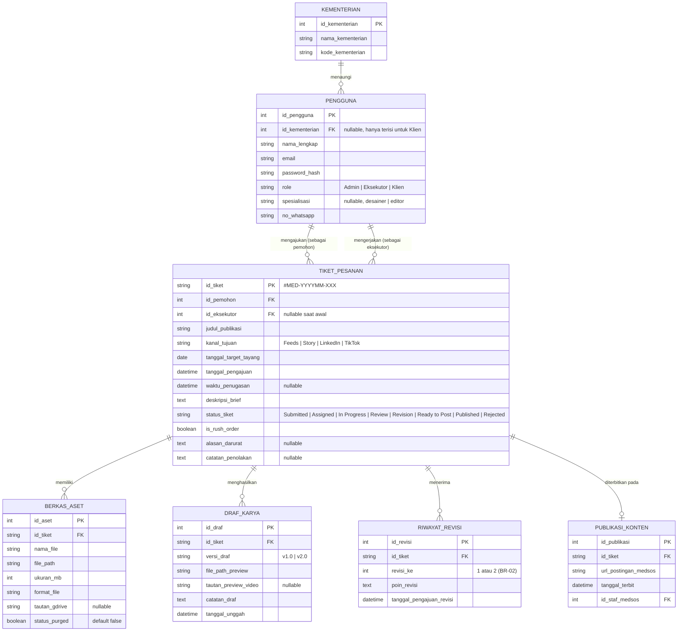

# Laporan Tugas Mandiri Pertemuan 10 – Pemodelan Data (ERD v1)
## IF21307 Analisis dan Desain Sistem

---

### Identitas Mahasiswa & Tugas
* **Nama Lengkap:** Fardizza Vinda Rahman
* **NIM:** H1D025067
* **Nama Tim Proyek:** Tim Medkreminfo (Kelompok Proyek ADS)
* **Judul Proyek SRS:** Sistem Informasi Layanan Pemesanan Konten Medkreminfo BEM FT UNSOED (Baseline v1.0)
* **Use Case Terpilih:** UC-02 – Validasi dan Penugasan Tiket Konten (Admin)

---

## Bagian A. Use Case Narrative yang Ditandai

Salinan apa adanya dari dokumen SRS Tim (Bab 6.2 UC-02), dengan penandaan:
* Kata benda (kandidat entitas / atribut) **ditebalkan (bold)**.
* Kata kerja (kandidat relasi) *dimiringkan (italic)*.

### UC-02: Validasi dan Penugasan Tiket Konten (Admin)
* **Aktor Utama:** **Admin** (**Menteri** / **Sekretaris Medkreminfo**)
* **Precondition:** Minimal terdapat satu **tiket** berstatus `Submitted` di dalam **antrean sistem**.
* **Trigger:** **Admin** *membuka* **detail tiket baru** pada **dasbor manajerial**.
* **Main Flow:**
  1. **Admin** *meninjau* **kesesuaian brief**, **kelayakan materi aset**, dan **target tanggal tayang**.
  2. **Admin** *menyetujui* **kelayakan tiket pesanan** (*Approve Brief*).
  3. **Admin** *membuka* **dropdown pemilihan staf eksekutor pelaksana**.
  4. **Sistem** *menampilkan* **daftar staf aktif** disertai **angka indikator beban kerja** **tiket aktif** masing-masing **staf**.
  5. **Admin** *memilih* **staf eksekutor** yang sesuai dengan **spesialisasi konten** (**desainer** / **editor**).
  6. **Admin** *mengonfirmasi* **penetapan tugas**.
  7. **Sistem** *memperbarui* **status tiket** menjadi `Assigned`, *menautkan* **ID eksekutor**, dan *mencatat* **histori waktu penugasan**.

* **Alternate Flow:**
  * *2a. Brief Tidak Memenuhi Standar:*
    1. **Admin** *menolak* **permohonan** atau *meminta* **revisi brief**.
    2. **Admin** *memasukkan* **alasan penolakan** / **kekurangan brief** pada **kolom keterangan**.
    3. **Sistem** *mengubah* **status tiket** menjadi `Revision Required` dan *mengirimkan* **informasi perbaikan** ke **dasbor Klien**.

* **Exception:**
  * *4a. Staf yang Dipilih Telah Memegang ≥ 3 Tiket Aktif (BR-04):*
    1. **Sistem** *memunculkan* **jendela dialog peringatan**: "Staf tersebut telah memegang 3 tugas aktif (Workload Limit). Lanjutkan?".
    2. **Admin** dapat *membatalkan* dan *memilih* **staf lain**, atau tetap *melanjutkan* **penugasan** dengan **konfirmasi manajerial khusus**.

* **Postcondition:** **Status tiket** *berubah* menjadi `Assigned`, **staf eksekutor** *menerima* **penugasan** di **dasbor tugas pribadinya**.

---

## Bagian B. Tabel Saring Kandidat

Penyaringan kandidat kata benda dari UC-02 untuk menentukan kelayakan sebagai entitas, atribut, atau bukan entitas:

| No | Kandidat Kata | Keputusan | Alasan Keputusan |
|:--:|---|---|---|
| 1 | Admin / Menteri / Staf eksekutor | **Entitas `PENGGUNA`** | Orangnya ada banyak dan masing-masing punya akun login, kontak WA, serta peran yang berbeda di sistem (FR-01). |
| 2 | Tiket / Tiket pesanan | **Entitas `TIKET_PESANAN`** | Data pesanan konten yang disimpan di sistem, punya nomor tiket sendiri, dan statusnya berubah-ubah dari masuk sampai terbit (FR-02). |
| 3 | Materi aset | **Entitas `BERKAS_ASET`** | File fisik (gambar/video) yang diunggah pemesan. Satu tiket bisa punya banyak file dan file-nya bakal dihapus otomatis saat selesai (auto-purge BR-05). |
| 4 | Kesesuaian brief / naskah brief | **Atribut `TIKET_PESANAN`** | Teks deskripsi konsep dan instruksi konten yang melekat menjelaskan satu tiket pesanan (FR-02). |
| 5 | Dasbor manajerial / Antrean sistem | **Bukan entitas** | Tampilan halaman web untuk memantau tiket; isinya diambil dari data tiket, bukan tabel tersendiri. |
| 6 | Dropdown pemilihan staf | **Bukan entitas** | Pilihan input pada formulir di layar saat Admin memilih staf, bukan data yang disimpan. |
| 7 | Angka indikator beban kerja | **Bukan entitas (dihitung)** | Bisa dihitung langsung (count) dari banyaknya tiket aktif berstatus *In Progress* yang dipegang staf (BR-04), jadi tidak perlu kolom tersendiri. |
| 8 | Spesialisasi konten (desainer / editor) | **Atribut `PENGGUNA`** | Keterangan keahlian teknis yang menjelaskan data profil seorang staf (FR-08). |
| 9 | Status tiket (`Submitted`, `Assigned`, dll.) | **Atribut `TIKET_PESANAN`** | Nilai penanda posisi tahapan pengerjaan tiket saat ini (FR-06, FR-07). |
| 10 | ID eksekutor *(ragu)* | **Atribut `TIKET_PESANAN` (FK)** | Mencatat ID staf yang ditugaskan mengerjakan tiket. *(Ragu)*: jika staf diganti di tengah jalan (fitur re-assign FR-09), apakah butuh tabel histori penugasan terpisah. Sementara di v1 saya pasang sebagai foreign key langsung. |
| 11 | Histori waktu penugasan | **Atribut `TIKET_PESANAN`** | Catatan tanggal dan jam saat Admin mengonfirmasi penetapan tugas ke staf (FR-08). |
| 12 | Alasan penolakan / kekurangan brief | **Atribut `TIKET_PESANAN`** | Catatan teks dari Admin ke pemesan jika formulir pesanan ditolak atau perlu direvisi (FR-07). |
| 13 | Jendela dialog peringatan (Workload Limit) | **Bukan entitas** | Pesan pop-up di layar saat staf terpilih sudah memegang 3 tugas aktif (BR-04), tidak disimpan ke database. |
| 14 | Target tanggal tayang | **Atribut `TIKET_PESANAN`** | Tanggal target publikasi konten yang menjelaskan tenggat waktu tiket tersebut (FR-02). |

---

## Bagian C – ERD v1

**Gambar 1. ERD v1 Medkreminfo · 7 entitas, 7 garis relasi**

ERD mencakup seluruh FR inti Medkreminfo, bukan hanya UC-02. Relasi penugasan staf dan berkas aset masih menyisakan pertanyaan yang dibahas pada Bagian D dan refleksi. Notasi memakai Crow's Foot.

### Legenda Notasi
* `||--o{` : One-to-Many (1 ke 0..N, satu baris sisi kiri berelasi ke nol atau banyak baris sisi kanan).
* `||--o|` : One-to-Optional-One (1 ke 0..1, satu baris sisi kiri berelasi ke maksimal satu baris sisi kanan).
* `PK` : Primary Key (kunci utama unik).
* `FK` : Foreign Key (kunci tamu penghubung relasi).
* `nullable` : Nilai kolom boleh kosong jika belum ada data pada tahap tersebut.

### Asal Entitas di Luar Use Case UC-02
Sesuai langkah pengerjaan poin 4, entitas yang tidak muncul di UC-02 ditelusuri dari FR dan bab lain di SRS:
1. **`KEMENTERIAN`** — Diambil dari Bab 2.3 poin 2 dan FR-02: sistem melayani 14 kementerian di lingkungan BEM FT sebagai organisasi pemohon konten.
2. **`DRAF_KARYA`** — Diambil dari FR-11 dan UC-03: menampung hasil desain/video luaran yang diunggah staf eksekutor (v1.0, v2.0) untuk ditinjau.
3. **`RIWAYAT_REVISI`** — Diambil dari FR-12, BR-02, dan UC-04: mencatat catatan revisi dari pemohon dengan batasan maksimal 2 kali.
4. **`PUBLIKASI_KONTEN`** — Diambil dari FR-14, FR-15, dan UC-04: menyimpan tautan postingan riil medsos dan waktu terbit, serta memicu pembersihan berkas fisik aset lokal (*auto-purge* BR-05).

---

## Bagian D – Bukti Relasi

Tabel verifikasi cardinality setiap relasi terhadap aturan pada dokumen SRS:

| No | Relasi (entitas – kata kerja – entitas) | Cardinality | Kutipan bukti dan ID (FR/BR) | Jika tidak ada bukti: pertanyaan ke stakeholder |
|:--:|---|:---:|---|---|
| 1 | KEMENTERIAN – menaungi – PENGGUNA | 1 : N | Sebagian. Bab 2.3 poin 2: *"Setiap kementerian di lingkungan BEM FT memiliki satu akun representatif resmi..."* hanya membuktikan sisi 1 akun (1:1). Bahwa satu kementerian bisa memiliki banyak akun (1:N) tidak ada buktinya di SRS dan merupakan tebakan saya jika ada penambahan staf per kementerian. | Apakah satu kementerian hanya boleh memiliki 1 akun login bersama, atau setiap pengurus kementerian boleh membuat akun login sendiri? |
| 2 | PENGGUNA – mengajukan – TIKET_PESANAN | 1 : N | FR-02: *"Sistem harus memungkinkan Klien membuat tiket pesanan baru melalui formulir terstruktur..."* membuktikan sisi pemohon. FR-05: *"Sistem harus menampilkan daftar riwayat tiket pesanan milik Klien..."* membuktikan satu akun pemohon bisa memiliki banyak tiket (sisi N). | – |
| 3 | PENGGUNA – mengerjakan – TIKET_PESANAN | 1 : N | FR-08: *"...menugaskan staf eksekutor ke tiket yang disetujui dengan menampilkan jumlah tiket aktif..."* dan BR-04: *"Staf eksekutor dibatasi memegang maksimal 3 tiket aktif secara bersamaan pada status In Progress..."*. Membuktikan satu staf bisa mengerjakan beberapa tiket sekaligus (sisi N, maksimal 3 aktif). | – |
| 4 | TIKET_PESANAN – memiliki – BERKAS_ASET | 1 : N | Sebagian. FR-04: *"Sistem harus memungkinkan pengguna mengunggah dan mengunduh berkas aset pendukung (gambar, naskah, maupun video mentahan > 50 MB)..."*. Frasa jamak membuktikan tiket bisa memiliki banyak berkas, tetapi batas maksimal jumlah berkasnya tidak disebutkan di SRS. | Berapa batas maksimal jumlah berkas yang boleh diunggah dalam satu tiket, dan adakah kuota total batas ukuran berkas (MB) per tiket pesanan? |
| 5 | TIKET_PESANAN – menghasilkan – DRAF_KARYA | 1 : N | FR-11: *"Sistem harus memungkinkan Eksekutor... mengunggah berkas/tautan draf karya (v1, v2) untuk ditinjau"* dan alur UC-03 langkah 6 & 6a. Membuktikan satu tiket menghasilkan minimal 1 draf (v1.0) dan maksimal 2 draf jika ada revisi (v2.0). | Apakah versi draf luaran mutlak dibatasi sampai v2.0 saja, atau boleh ada v3.0 jika ada kebijakan perbaikan khusus dari Menteri Medkreminfo? |
| 6 | TIKET_PESANAN – menerima – RIWAYAT_REVISI | 1 : N | BR-02: *"Setiap tiket pesanan hanya berhak atas maksimal 2 kali siklus revisi minor..."* dan FR-12: *"Sistem harus memfasilitasi Klien untuk mengajukan catatan revisi minor dengan pembatasan maksimal 2 kali siklus revisi (BR-02)..."*. Membuktikan satu tiket menerima 0 sampai maksimal 2 catatan revisi. | – |
| 7 | TIKET_PESANAN – diterbitkan pada – PUBLIKASI_KONTEN | 1 : 1 | FR-15: *"Sistem harus memungkinkan staf pengelola media sosial memperbarui status tiket menjadi Published dengan menyematkan URL tautan postingan yang telah tayang di media sosial..."*. Membuktikan satu tiket yang selesai hanya dipetakan ke tepat satu rekaman publikasi tayang. | – |

Persetujuan brief oleh Admin (FR-07) dan proses pembersihan berkas (*auto-purge* BR-05) belum saya gambar sebagai entitas/relasi tersendiri, melainkan dicatat sebagai atribut perubahan status tiket dan penanda status berkas aset. Alasannya ada di refleksi.

---

## Bagian E – Refleksi

**1. Bagian ERD mana yang paling saya ragukan, dan mengapa?**  
Bagian yang paling saya ragukan adalah pencatatan penugasan staf yang saat ini langsung saya tempel sebagai atribut foreign key `id_eksekutor` di `TIKET_PESANAN`. Pada SRS sebenarnya terdapat fitur pengalihan penugasan (*re-assign* di FR-09) jika staf awal overload atau berhalangan, serta kewajiban mencatat histori mutasi di changelog tiket (AC-11). Jika hanya disimpan sebagai satu kolom di tiket, sistem akan menimpa data staf lama dan kehilangan jejak siapa yang pernah mengerjakan sebelumnya. Seharusnya relasi ini dibuat melalui entitas perantara seperti `LOG_PENUGASAN`, namun untuk draf v1 ini saya sederhanakan terlebih dahulu.

**2. Keputusan apa yang saya ambil berdasarkan tebakan, bukan dokumen?**  
Saya menebak kardinalitas relasi `KEMENTERIAN` ke `PENGGUNA` adalah 1 : N karena saya berasumsi satu kementerian mungkin punya beberapa orang pengurus yang butuh akun sendiri. Padahal di dokumen SRS Bab 2.3 poin 2 tertulis jelas bahwa tiap kementerian memiliki satu akun representatif resmi (1 : 1). Selain itu, saya juga menebak bahwa satu tiket bisa memuat banyak berkas aset (1 : N) dari kata jamak di FR-04, tanpa tahu apakah ada batasan maksimal jumlah file yang boleh diunggah per pesanan.

**3. Data apa yang mungkin dibutuhkan sistem tetapi belum ada di ERD saya?**  
Sistem belum memiliki entitas atau atribut untuk mencatat riwayat notifikasi konfirmasi dan pengingat jadwal posting (FR-02 dan FR-14). Selain itu, ERD saya belum memuat pencatatan alasan detail penolakan brief jika terjadi revisi berulang antara Admin dan Klien sebelum tiket disetujui (FR-07). Terakhir, data log audit perubahan staf saat *re-assignment* juga belum bisa ditampung karena belum adanya tabel histori penugasan.

